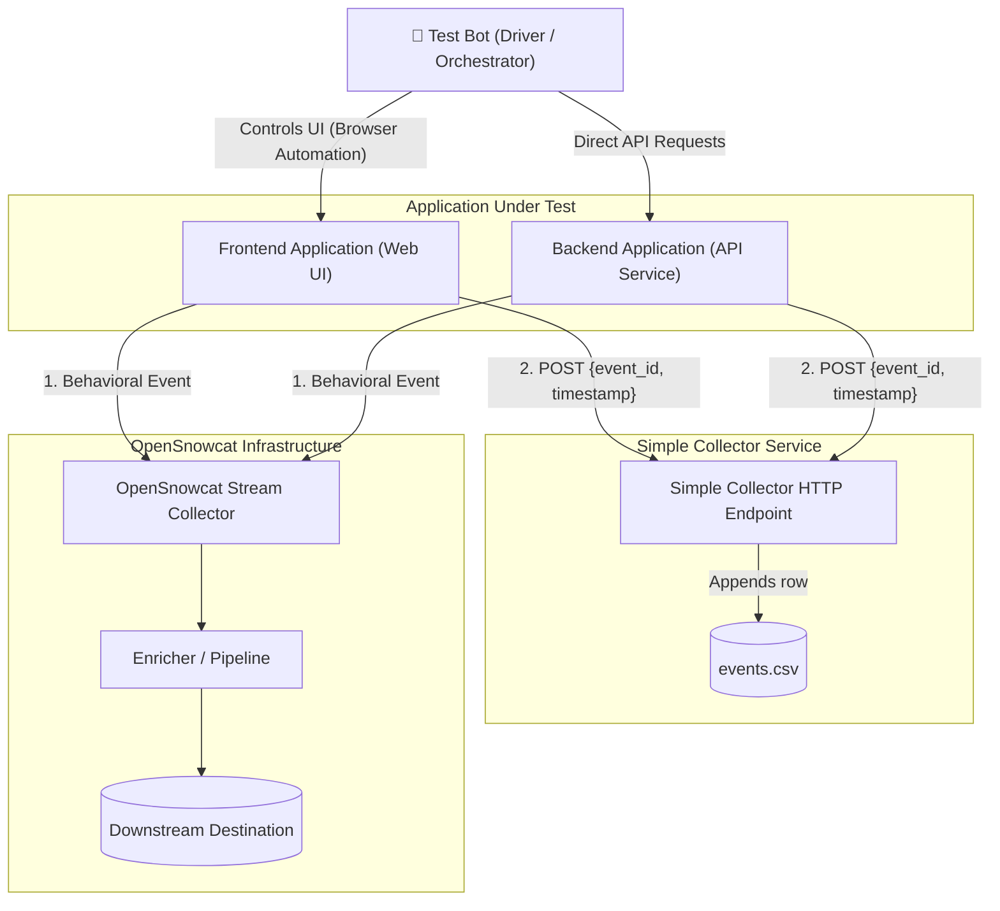
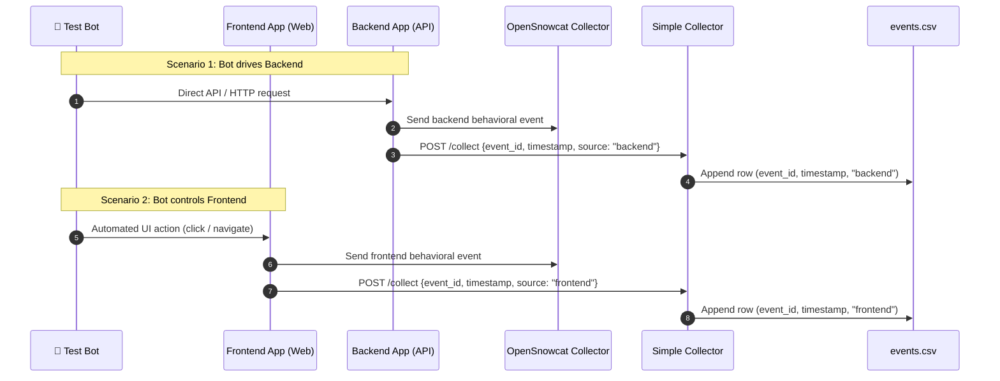

# OpenSnowcat Event Testing Tool (`opensnowcat-events-test`)

> **Project Reference:** For problem statement, testing scope boundaries, key objectives, and the development roadmap, see [**Project Specification (`project.md`)**](project.md).

---

## 1. Architecture & Workflow

### 1.1 Component Architecture



### 1.2 Iteration Sequence



---

## 2. Key Functional Modules

Detailed architectural and implementation specifications for each module are documented in dedicated guides:

| Module | Description | Detailed Guide |
|---|---|---|
| **Project Specification** | Problem statement, objectives, scope boundaries & roadmap | [project.md](project.md) |
| **Module 1: Test Bot** | Headless browser driver & API client orchestrating the tests | [modules/test-bot.md](modules/test-bot.md) |
| **Module 2: Frontend Producer** | Web app embedding OpenSnowcat JS tracker + Simple Collector reporter | [modules/frontend-producer.md](modules/frontend-producer.md) |
| **Module 3: Backend Producer** | API service emitting OpenSnowcat server events + Simple Collector reporter | [modules/backend-producer.md](modules/backend-producer.md) |
| **Module 4: Simple Collector** | Audit HTTP service appending `event_id, timestamp, source` to `events.csv` | [modules/simple-collector.md](modules/simple-collector.md) |
| **Container Standards** | Service Dockerfiles & container standards | [modules/docker.md](modules/docker.md) |
| **Docker Compose Orchestration** | Multi-service orchestration & execution profiles | [modules/docker-compose.md](modules/docker-compose.md) |

---

### Module 1: [Test Bot (Driver / Orchestrator)](modules/test-bot.md)
- Automated runner that executes test scenarios.
- **Frontend Controller:** Drives a headless browser (e.g., Playwright or Puppeteer) to interact with the Frontend UI.
- **Backend Requester:** Issues direct HTTP calls to the Backend endpoints.
- Configurable scenario parameters: iteration counts, concurrency, delays/pacing.
- *Full specification:* [modules/test-bot.md](modules/test-bot.md)

### Module 2: [Frontend Producer (Web Application)](modules/frontend-producer.md)
- Web application built with **React** running on **Node.js 26** embedding the OpenSnowcat JavaScript tracker.
- Features **5 distinct pages**:
  1. `/` — Home dashboard with links to all services and global event counters.
  2. `/calc` — Simple Calculator (delegates computation to backend `POST /api/calc`).
  3. `/timestamp` — Current Timestamp in User's Location (delegates to backend `POST /api/timestamp`).
  4. `/excuse` — Daily Standup Excuse Generator (delegates to backend `GET /api/daily-excuse`).
  5. `/dice` — Dice Emulator (delegates to backend `POST /api/dice`).
- **Constraint:** All 4 services cannot be processed in the browser; they delegate processing to the Backend Producer API.
- **Event Types Emitted:**
  - **No-Schema Events:** `trackPageView` (route transitions) and `trackStructEvent` (service actions).
  - **Self-Describing Events:** `trackSelfDescribingEvent` with official Iglu Central wildcard schema `anything-a` (`iglu:com.snowplowanalytics.iglu/anything-a/jsonschema/1-0-0`) for schema-agnostic service payload emission.
- On each event generation:
  1. Emits the event to OpenSnowcat Collector.
  2. Sends an HTTP audit request to Simple Collector (`POST /collect` with `source: "frontend"`).
- *Full specification:* [modules/frontend-producer.md](modules/frontend-producer.md)

### Module 3: [Backend Producer (API Service)](modules/backend-producer.md)
- Web application built with **Next.js** running on **Node.js 26**.
- Implements a strict **3-tier architecture**:
  - **Controller Layer:** Route handlers with colocated Zod schemas (`schema.ts` + `route.ts`) validating request bodies via `safeParse()`. *Constraint: ONLY calls Business.*
  - **Business Layer:** Domain logic, domain objects, and services. Generates `event_id` and `timestamp`. *Constraint: ONLY layer that calls External.*
  - **External Layer:** Outbound clients for OpenSnowcat Collector (`/tp2`) and Simple Collector (`/collect`).
- *Full specification:* [modules/backend-producer.md](modules/backend-producer.md)

### Module 4: [Simple Collector Service](modules/simple-collector.md)
- Lightweight, high-performance audit HTTP service built with **Fastify** running on **Node.js 26**.
- Exposes endpoint: `POST /collect` receiving `{ event_id, timestamp, source, event_type }`.
- Persists events **strictly sequentially** using an async FIFO queue in **append-only** mode.
- Output location configurable via the `CSV_FILE_PATH` environment variable (defaults to `./data/events.csv`).
- Appends rows directly to the CSV:
  ```csv
  event_id,timestamp,source,event_type
  c1a2b3c4-d5e6-7890-abcd-ef1234567890,2026-10-11T14:30:00.123Z,backend,backend_api
  d2e3f4a5-b6c7-8901-cdef-1234567890ab,2026-10-11T14:30:01.456Z,frontend,page_view
  ```
- *Full specification:* [modules/simple-collector.md](modules/simple-collector.md)

---

## 3. Repository Organization (`apps/` Monorepo)

The project is structured as a modular Monorepo where all 4 independent applications live inside the `apps/` directory. Each application maintains its own isolated `package.json`, `Dockerfile`, dependencies, configuration, and test suites:

```
opensnowcat-events-test/
├── AGENTS.md                          # AI Agent & Developer orientation guide
├── docs/
│   ├── README.md                      # Master architecture, workflow & index
│   ├── project.md                     # Project goals, problem statement & roadmap
│   └── modules/
│       ├── test-bot.md                # Module 1: Test Bot Specification
│       ├── frontend-producer.md       # Module 2: Frontend Producer Specification
│       ├── backend-producer.md        # Module 3: Backend Producer Specification
│       ├── simple-collector.md        # Module 4: Simple Collector Specification
│       ├── docker.md                  # Container standards & Dockerfile references
│       └── docker-compose.md          # Multi-service compose orchestration
│
├── apps/
│   ├── backend-producer/              # Next.js 15+ API Service (Port 4000)
│   ├── frontend-producer/             # React 19 + Vite Web Application (Port 3000)
│   ├── simple-collector/              # Fastify CSV Audit Logger (Port 5000)
│   └── test-bot/                      # Playwright Automated Runner (CLI / Port 6000)
│
├── data/                              # Host-mounted volume directory (stores events.csv)
├── test/                              # Local OpenSnowcat Collector (Docker + Node emulator on :8080)
├── docker-compose.yml                 # Multi-service Docker Compose orchestration
└── package.json                       # Root monorepo scripts & orchestration commands
```

### Benefits of the `apps/` Isolation:
1. **Isolated Runtimes & Dependencies:** Eliminates version conflicts between frontend (React 19 / Vite) and backend (Next.js 15+), as well as Fastify and Playwright.
2. **Independent Testing:** Each service runs its own targeted unit and integration tests (`npm --prefix apps/simple-collector test`), or all together from the root (`npm test`).
3. **Dedicated Docker Contexts:** Each application in `apps/` builds into an isolated, lean container without unnecessary dependencies from other services (detailed in [modules/docker.md](modules/docker.md)).

### Root Single-Command Scripts (`package.json`):
From the repository root, you can build, type-check, test, or run all services with a single command:

```bash
# Type-check all 4 applications
npm run type-check

# Build all 4 applications
npm run build

# Run all unit and integration tests across all 4 applications
npm test

# Start only the local OpenSnowcat Collector on port 8080
npm run snowcat

# Start OpenSnowcat (:8080), Simple Collector (:5000), Backend Producer (:4000), and Frontend Producer (:3000) locally
npm run dev

# Execute Test Bot against running local services
npm run bot -- --iterations 10 --concurrency 2

# Start all 4 services (including OpenSnowcat :8080) in background, wait for health checks, and run Test Bot E2E locally
npm run e2e -- --iterations 10 --concurrency 2

# Start all containerized services via Docker Compose
npm run up

# Build, start all containers, and run the automated Test Bot E2E suite
npm run e2e:docker
```

---

## 4. Multi-Service Orchestration (`docker-compose`)

Multi-service orchestration coordinates service startup order via health checks and mounts `./data:/app/data` to preserve the output `events.csv`.

*Full Compose specification, service sequencing, and execution profiles are documented in [**`modules/docker-compose.md`**](modules/docker-compose.md).*

```bash
# 1. Start application services only (manual browser testing)
docker compose up --build

# 2. Run full automated end-to-end test suite (starts services + runs Test Bot)
docker compose --profile full-test up --build

# 3. Trigger Test Bot on-demand with custom parameters
docker compose run --rm test-bot npx tsx src/index.ts \
  --frontend-url http://frontend-producer:3000 \
  --backend-url http://backend-producer:4000 \
  --iterations 500 \
  --concurrency 5

# 4. Teardown all containers (preserves ./data/events.csv on host)
docker compose down
```

*For individual service Dockerfiles and container standards, see [modules/docker.md](modules/docker.md).*

---

## 5. Code Quality, Linting & Static Analysis

Each application in `apps/` uses TypeScript with strict mode enabled and provides a standardized `type-check` script for static analysis and type linting (`tsc --noEmit`). This validates strict typing, syntax correctness, module import integrity, and unused symbols without emitting build artifacts.

### Running Linting & Type-Checking

Run static analysis in any application directory:

```bash
# Simple Collector (Fastify Audit Service)
cd apps/simple-collector
npm run type-check

# Backend Producer (Next.js API Service)
cd apps/backend-producer
npm run type-check
```

Before committing code or submitting pull requests, ensure that:
1. All static analysis passes without errors (`npm run type-check`).
2. All unit and integration test suites pass (`npm test`).
3. See [CONTRIBUTING.md](../CONTRIBUTING.md) for pull request requirements and code quality guidelines.

---

## 6. Technical Specifications & Choices

1. **Test Bot Engine:** **Playwright** on **Node.js 26** (using native ESM and native `fetch`).
2. **Frontend Producer:** **React 19** + **Vite** on **Node.js 26** (5 pages with backend delegation).
3. **Backend Producer:** **Next.js** on **Node.js 26** (Controller $\rightarrow$ Business $\rightarrow$ External).
4. **Simple Collector Stack:** **Fastify** on **Node.js 26** (sequential append-only CSV persistence).
5. **OpenSnowcat Collector Endpoint:** Configurable target OpenSnowcat collector URL (default: `http://localhost:8080`).
6. **Project Scope & Roadmap:** For the development roadmap and testing objectives, see [**Project Specification (`project.md`)**](project.md).

