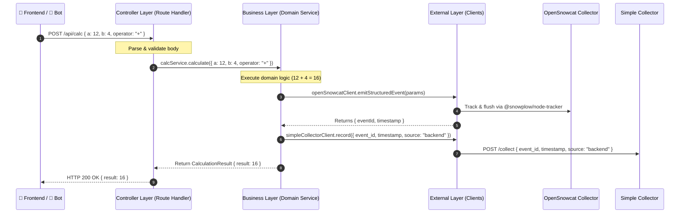

# Module 3: Backend Producer (API Service)

## 1. Overview
The **Backend Producer** is a server-side web application built with **Next.js** running on **Node.js 26**. It exposes the API endpoints required by the **Frontend Application** and the **Test Bot**.

For every processed request, the Backend Producer:
1. Executes the business logic (calculating, timezone formatting, excuse generation, dice rolling).
2. Generates an `event_id` (UUIDv4) and precise `timestamp` (ISO-8601 UTC).
3. Emits an official OpenSnowcat server-side tracking event to the OpenSnowcat Stream Collector (`/com.snowplowanalytics.snowplow/tp2`).
4. Simultaneously sends an audit record to the **Simple Collector** (`POST /collect` with `source: "backend"`).
5. Returns the response to the caller.

---

## 2. Layered Architecture & Dependency Rules

The application strictly enforces a **3-tier architectural separation**:

```
┌────────────────────────────────────────────────────────────────────────┐
│                        BACKEND ARCHITECTURE                            │
│                                                                        │
│   ┌──────────────────────────────────────────────────────────────┐     │
│   │ 1. CONTROLLER LAYER                                          │     │
│   │    - Next.js Route Handlers (app/api/.../route.ts)           │     │
│   │    - Parses & validates HTTP Request Body & Query Params     │     │
│   │    - Returns HTTP Response (Status codes & JSON)             │     │
│   │    - RULE: ONLY calls the Business Layer                     │     │
│   └──────────────────────────────┬───────────────────────────────┘     │
│                                  │ calls                               │
│                                  ▼                                     │
│   ┌──────────────────────────────────────────────────────────────┐     │
│   │ 2. BUSINESS LAYER                                            │     │
│   │    - Domain entities, value objects, and business rules      │     │
│   │    - Services (CalcService, TimestampService, ExcuseService) │     │
│   │    - Generates event_id and timestamp                        │     │
│   │    - RULE: ONLY layer permitted to call External services    │     │
│   └──────────────────────────────┬───────────────────────────────┘     │
│                                  │ calls                               │
│                                  ▼                                     │
│   ┌──────────────────────────────────────────────────────────────┐     │
│   │ 3. EXTERNAL LAYER                                            │     │
│   │    - External HTTP clients & service adapters                │     │
│   │    - OpenSnowcat Collector Client (/tp2)                     │     │
│   │    - Simple Collector Client (/collect)                      │     │
│   │    - RULE: Does not call Business or Controller              │     │
│   └──────────────────────────────────────────────────────────────┘     │
└────────────────────────────────────────────────────────────────────────┘
```

### Strict Enforcement Rules:
1. **Controller $\rightarrow$ Business ONLY:** Controllers handle HTTP requests and delegate directly to Business services. Controllers **must never** import or call the External layer directly.
2. **Business $\rightarrow$ External ONLY:** Only Business services are allowed to invoke External service clients (OpenSnowcat and Simple Collector).
3. **No Inverted Dependencies:** The External layer has no knowledge of Controllers or Business services.

---

## 3. Interaction Flow



---

## 4. Directory & Code Structure

Direct reference to the files implementing the service in [`apps/backend-producer/`](../../apps/backend-producer/):

```
apps/backend-producer/
├── package.json                            # Scripts & dependency definitions
├── tsconfig.json                           # TypeScript configuration
├── next.config.ts                          # Next.js standalone output configuration
├── vitest.config.ts                        # Vitest configuration & path aliases (@/*)
├── Dockerfile                              # Multi-stage production container build
├── .env.example                            # Sample environment variables
├── src/
│   ├── app/
│   │   └── api/                            # 1. CONTROLLER LAYER (Next.js Route Handlers + Zod DTOs)
│   │       ├── error-handler.ts            # Route error mapper (BusinessError -> HTTP response)
│   │       ├── calc/
│   │       │   ├── schema.ts               # Zod Request & Response Schemas
│   │       │   ├── route.ts                # POST /api/calc handler
│   │       │   └── route.test.ts           # Controller unit test
│   │       ├── timestamp/
│   │       │   ├── schema.ts               # Zod Request & Response Schemas
│   │       │   ├── route.ts                # POST /api/timestamp handler
│   │       │   └── route.test.ts           # Controller unit test
│   │       ├── daily-excuse/
│   │       │   ├── schema.ts               # Zod Response Schema
│   │       │   ├── route.ts                # GET /api/daily-excuse handler
│   │       │   └── route.test.ts           # Controller unit test
│   │       ├── dice/
│   │       │   ├── schema.ts               # Zod Request & Response Schemas
│   │       │   ├── route.ts                # POST /api/dice handler
│   │       │   └── route.test.ts           # Controller unit test
│   │       ├── batch/
│   │       │   ├── schema.ts               # Zod Request & Response Schemas
│   │       │   ├── route.ts                # POST /api/batch handler
│   │       │   └── route.test.ts           # Controller unit test
│   │       └── health/
│   │           ├── route.ts                # GET /api/health handler
│   │           └── route.test.ts           # Controller unit test
│   │
│   ├── business/                           # 2. BUSINESS LAYER (Domain & Services)
│   │   ├── tracking.dispatcher.ts          # Unified dual emission dispatcher
│   │   ├── tracking.dispatcher.test.ts     # Dispatcher unit tests
│   │   ├── errors/                         # Strongly-Typed Business Errors
│   │   │   ├── business.error.ts           # Domain BusinessError hierarchy
│   │   │   └── business.error.test.ts      # Error class unit tests
│   │   ├── domain/                         # Domain Entities, Value Objects & Models
│   │   │   ├── calculation.ts              # Calculation entity & operator rules
│   │   │   ├── calculation.test.ts         # Domain unit tests
│   │   │   ├── timestamp-info.ts           # TimeLocation model & timezone helpers
│   │   │   ├── timestamp-info.test.ts      # Domain unit tests
│   │   │   ├── excuse.ts                   # Excuse entity & quote repository
│   │   │   ├── excuse.test.ts              # Domain unit tests
│   │   │   ├── dice-roll.ts                # DiceRoll model & polyhedral sides mapping
│   │   │   └── dice-roll.test.ts           # Domain unit tests
│   │   │
│   │   └── services/                       # Business Domain Services
│   │       ├── calc.service.ts             # Arithmetic execution & dual emission
│   │       ├── calc.service.test.ts        # Service unit tests
│   │       ├── timestamp.service.ts        # Timezone formatting & dual emission
│   │       ├── timestamp.service.test.ts   # Service unit tests
│   │       ├── excuse.service.ts           # Excuse selection & dual emission
│   │       ├── excuse.service.test.ts      # Service unit tests
│   │       ├── dice.service.ts             # Random dice generator & dual emission
│   │       ├── dice.service.test.ts        # Service unit tests
│   │       ├── batch.service.ts            # Bulk event loop orchestrator
│   │       └── batch.service.test.ts       # Service unit tests
│   │
│   ├── external/                           # 3. EXTERNAL LAYER (Third-Party Clients)
│   │   ├── opensnowcat.client.ts           # OpenSnowcat Stream Collector client (/tp2)
│   │   ├── opensnowcat.client.test.ts      # Client unit tests
│   │   ├── simple-collector.client.ts      # Simple Collector audit client (/collect)
│   │   └── simple-collector.client.test.ts # Client unit tests
│   ├── middleware.ts                       # Next.js Middleware (CORS & OPTIONS preflight)
│   └── middleware.test.ts                  # Middleware unit tests
└── tests/
    └── integration/                        # Full API lifecycle tests (external clients mocked)
        ├── api-calc.integration.test.ts
        ├── api-timestamp.integration.test.ts
        ├── api-daily-excuse.integration.test.ts
        ├── api-dice.integration.test.ts
        ├── api-batch.integration.test.ts
        ├── api-health.integration.test.ts
        └── cors.integration.test.ts
```

---

## 5. Layer Specifications & Implementation

### 5.1 Controller Layer: Schema Objects (DTOs) vs. Domain Objects

The API boundary strictly distinguishes between **Schema Objects** and **Domain Objects**:
- **Schema Objects (`schema.ts`):** Represent the public HTTP contract. Every endpoint defines both a **`RequestSchema`** (validating input via Zod) and a **`ResponseSchema`** (defining the public output shape). The endpoint **always returns a Schema Object** in the HTTP body.
- **Domain Objects (`src/business/domain/`):** Represent internal business entities, rules, and calculations. Domain objects are internal to the Business layer and are **never exposed directly over the network**.
- **Mapping:** The Controller invokes the Business service, receives a Domain Object, and maps it into the public `ResponseSchema` object.
- **Centralized Route Error Handling (`src/app/api/error-handler.ts`):** All controllers catch errors and delegate to `handleRouteError(error)`. Domain errors extending `BusinessError` map to HTTP 400 Bad Request with `{ error: error.message }`. Unexpected system errors or unhandled exceptions fallback cleanly to HTTP 500 (`{ error: 'Internal Server Error', message }`). Controllers never perform string matching on error messages.

```
Request JSON ──> [RequestSchema.safeParse] ──> Controller ──> Business (operates on Domain Object)
                                                 │
                                                 ├── Success ──> [ResponseSchema] ──> Response JSON
                                                 └── Catch   ──> [handleRouteError] ──> Error JSON
```

#### Colocated Schemas and Route Handlers:
Each API route collocates its Zod schema definition directly with its Next.js route handler:

- **Calculation:** [`schema.ts`](../../apps/backend-producer/src/app/api/calc/schema.ts) defines `CalcRequestSchema` (`a`, `b`, `operator`) and `CalcResponseSchema` (`result`). Implemented by [`route.ts`](../../apps/backend-producer/src/app/api/calc/route.ts).
- **Location Timestamp:** [`schema.ts`](../../apps/backend-producer/src/app/api/timestamp/schema.ts) defines `TimestampRequestSchema` (`timezone`) and `TimestampResponseSchema` (`timestamp_iso`, `formatted_local`, `timezone`). Implemented by [`route.ts`](../../apps/backend-producer/src/app/api/timestamp/route.ts).
- **Daily Excuse:** [`schema.ts`](../../apps/backend-producer/src/app/api/daily-excuse/schema.ts) defines `DailyExcuseResponseSchema` (`id`, `excuse`). Implemented by [`route.ts`](../../apps/backend-producer/src/app/api/daily-excuse/route.ts).
- **Dice Emulator:** [`schema.ts`](../../apps/backend-producer/src/app/api/dice/schema.ts) defines `DiceRequestSchema` (`count`, `sides`) and `DiceResponseSchema` (`rolls`, `total`). Implemented by [`route.ts`](../../apps/backend-producer/src/app/api/dice/route.ts).
- **Batch Simulator:** [`schema.ts`](../../apps/backend-producer/src/app/api/batch/schema.ts) defines `BatchRequestSchema` (`count`) and `BatchResponseSchema` (`status`, `events_emitted`). Implemented by [`route.ts`](../../apps/backend-producer/src/app/api/batch/route.ts).
- **Health Check:** Implemented by [`route.ts`](../../apps/backend-producer/src/app/api/health/route.ts).

---

### 5.2 Business Layer (`src/business/`)

The Business Layer encapsulates all business rules, domain entities, tracking metadata generation, and orchestration of external tracking emissions:

- **Domain Business Errors ([`src/business/errors/`](../../apps/backend-producer/src/business/errors/)):**
  - [`business.error.ts`](../../apps/backend-producer/src/business/errors/business.error.ts): Strongly-typed domain error hierarchy rooted at `BusinessError` (pure domain errors decoupled from HTTP concerns).
    - `DivisionByZeroError`: Thrown on arithmetic division by zero.
    - `UnsupportedOperatorError`: Thrown when an invalid or unpermitted mathematical operator is provided.
    - `InvalidTimezoneError`: Thrown when an invalid IANA timezone identifier is provided.
    - `InvalidDiceError`: Thrown when dice roll count or sides violate game rules.
    - `InvalidBatchCountError`: Thrown when batch simulator iteration count violates bounds (1–1000).

- **Domain Entities ([`src/business/domain/`](../../apps/backend-producer/src/business/domain/)):**
  - [`calculation.ts`](../../apps/backend-producer/src/business/domain/calculation.ts): `Calculation` entity holding inputs, operator, result, and division validation rules.
  - [`timestamp-info.ts`](../../apps/backend-producer/src/business/domain/timestamp-info.ts): `TimeLocation` entity and timezone validation helper (`isValidTimezone`).
  - [`excuse.ts`](../../apps/backend-producer/src/business/domain/excuse.ts): `Excuse` entity and repository pool of humorous developer excuses.
  - [`dice-roll.ts`](../../apps/backend-producer/src/business/domain/dice-roll.ts): `DiceRoll` entity supporting polyhedral dice (`d4`, `d6`, `d8`, `d10`, `d12`, `d20`, `d100`).

- **Business Services ([`src/business/services/`](../../apps/backend-producer/src/business/services/)):**
  - [`calc.service.ts`](../../apps/backend-producer/src/business/services/calc.service.ts): Executes arithmetic operations (`+`, `-`, `*`, `/`), enforces division by zero protection, and triggers dual tracking.
  - [`timestamp.service.ts`](../../apps/backend-producer/src/business/services/timestamp.service.ts): Generates ISO-8601 timestamps and localized time representations across timezones, triggering dual tracking.
  - [`excuse.service.ts`](../../apps/backend-producer/src/business/services/excuse.service.ts): Randomly selects excuse entities from the domain pool and triggers dual tracking.
  - [`dice.service.ts`](../../apps/backend-producer/src/business/services/dice.service.ts): Rolls polyhedral dice, aggregates totals, and triggers dual tracking.
  - [`batch.service.ts`](../../apps/backend-producer/src/business/services/batch.service.ts): Processes bulk events in sequential chunks of 5 (`CHUNK_SIZE = 5`) using `Promise.all` per chunk. This chunked execution pattern prevents socket exhaustion (never exceeding 10 concurrent outgoing sockets for dual emission — 5 to OpenSnowcat and 5 to Simple Collector) and prevents overwhelming downstream consumers like `simple-collector`'s FIFO Promise CSV write queue or OpenSnowcat.

- **Dual Emission Tracking Dispatcher ([`src/business/tracking.dispatcher.ts`](../../apps/backend-producer/src/business/tracking.dispatcher.ts)):**
  - Encapsulates dual emission dispatch logic used across all business services (`dispatchDualEmission`).
  - Emits tracking events to OpenSnowcat via official `@snowplow/node-tracker` without requiring `eventId` or `timestamp` in `DualEmissionParams`.
  - Extracts the resulting `eventId` from OpenSnowcat (falling back to nil zeros UUID `00000000-0000-0000-0000-000000000000` if OpenSnowcat does not return an event ID) and `timestamp` (ISO-8601 UTC).
  - Sequentially records audit logs to Simple Collector (`simpleCollectorClient.record`) with identical `eventId` and `timestamp`, guaranteeing telemetry and audit parity.

---

### 5.3 External Layer (`src/external/`)

The External Layer manages outbound HTTP communication with external services, isolating third-party network APIs from the domain layer:

- **OpenSnowcat Client ([`src/external/opensnowcat.client.ts`](../../apps/backend-producer/src/external/opensnowcat.client.ts)):**
  - Powered by official `@snowplow/node-tracker` (`newTracker`, `buildStructEvent`).
  - Automatically parses collector URL host, port, and protocol.
  - Emits structured events with single-buffered emitter and flushes to OpenSnowcat Collector.
  - Returns generated `eventId` and `timestamp` from the tracker payload for audit parity.
- **Simple Collector Client ([`src/external/simple-collector.client.ts`](../../apps/backend-producer/src/external/simple-collector.client.ts)):**
  - Targets `POST ${SIMPLE_COLLECTOR_URL}/collect`.
  - Dispatches audit record `{ event_id, timestamp, source: "backend", event_type: "backend_api" }`.
  - Catches and logs errors without bubbling to preserve business request flow.

---

### 5.4 Cross-Origin Resource Sharing (CORS) & Middleware (`src/middleware.ts`)

The Frontend application (running on port 3000 in browser) delegates calculations, timestamps, excuses, and dice rolls to the Backend Producer (running on port 4000). To support cross-origin browser requests without being blocked by CORS policies, the Backend Producer implements CORS support at two complementary levels:

1. **Next.js Middleware ([`src/middleware.ts`](../../apps/backend-producer/src/middleware.ts)):**
   - **Matcher Config:** Intercepts requests matching `['/api/:path*']`.
   - **Path Filter:** Checks if the request URL pathname starts with `/api/`. Non-API paths pass through without modification.
   - **OPTIONS Preflight Requests:** When a browser issues an HTTP `OPTIONS` preflight call, the middleware short-circuits execution and returns `HTTP 204 No Content` with the following headers:
     - `Access-Control-Allow-Origin`: `process.env.CORS_ORIGIN || '*'`
     - `Access-Control-Allow-Methods`: `'GET, POST, PUT, DELETE, OPTIONS'`
     - `Access-Control-Allow-Headers`: `'Content-Type, Authorization, X-Requested-With'`
     - `Access-Control-Max-Age`: `'86400'`
   - **Normal Requests:** Passes requests through via `NextResponse.next()` and adds CORS headers (`Access-Control-Allow-Origin`, `Access-Control-Allow-Methods`, `Access-Control-Allow-Headers`).
   - **Environment Configuration:** Respects the `CORS_ORIGIN` environment variable (defaulting to `*` if unspecified).

2. **Next.js Server Configuration ([`next.config.ts`](../../apps/backend-producer/next.config.ts)):**
   - Implements `async headers()` returning CORS headers for `/api/:path*`, ensuring framework-level header consistency.

---

## 6. API Endpoints Reference

### 6.1 Service Endpoints

#### `POST /api/calc`
- **Controller:** [`src/app/api/calc/route.ts`](../../apps/backend-producer/src/app/api/calc/route.ts)
- **Schema:** [`src/app/api/calc/schema.ts`](../../apps/backend-producer/src/app/api/calc/schema.ts)
- **Request Body:**
  ```json
  {
    "a": 12,
    "b": 4,
    "operator": "+"
  }
  ```
- **Response (`200 OK`):**
  ```json
  {
    "result": 16
  }
  ```

#### `POST /api/timestamp`
- **Controller:** [`src/app/api/timestamp/route.ts`](../../apps/backend-producer/src/app/api/timestamp/route.ts)
- **Schema:** [`src/app/api/timestamp/schema.ts`](../../apps/backend-producer/src/app/api/timestamp/schema.ts)
- **Request Body:**
  ```json
  {
    "timezone": "America/Sao_Paulo"
  }
  ```
- **Response (`200 OK`):**
  ```json
  {
    "timestamp_iso": "2026-10-11T14:30:00.123Z",
    "formatted_local": "11/10/2026, 11:30:00",
    "timezone": "America/Sao_Paulo"
  }
  ```

#### `GET /api/daily-excuse`
- **Controller:** [`src/app/api/daily-excuse/route.ts`](../../apps/backend-producer/src/app/api/daily-excuse/route.ts)
- **Schema:** [`src/app/api/daily-excuse/schema.ts`](../../apps/backend-producer/src/app/api/daily-excuse/schema.ts)
- **Response (`200 OK`):**
  ```json
  {
    "id": 14,
    "excuse": "My branch has 87 merge conflicts and git is currently in a detached HEAD existential crisis."
  }
  ```

#### `POST /api/dice`
- **Controller:** [`src/app/api/dice/route.ts`](../../apps/backend-producer/src/app/api/dice/route.ts)
- **Schema:** [`src/app/api/dice/schema.ts`](../../apps/backend-producer/src/app/api/dice/schema.ts)
- **Request Body:**
  ```json
  {
    "count": 2,
    "sides": "d6"
  }
  ```
- **Response (`200 OK`):**
  ```json
  {
    "rolls": [3, 5],
    "total": 8
  }
  ```

---

### 6.2 System & Testing Endpoints

#### `POST /api/batch`
- **Controller:** [`src/app/api/batch/route.ts`](../../apps/backend-producer/src/app/api/batch/route.ts)
- **Schema:** [`src/app/api/batch/schema.ts`](../../apps/backend-producer/src/app/api/batch/schema.ts)
- **Execution Pattern & Concurrency Control:**
  - `BatchService` processes bulk events in sequential chunks of 5 (`CHUNK_SIZE = 5`) using `Promise.all` per chunk.
  - **Architectural Rationale:**
    - **Prevents Socket Exhaustion:** Dual emission dispatches 2 outbound HTTP requests per event (one to OpenSnowcat `/tp2` and one to Simple Collector `/collect`). Restricting concurrency to chunks of 5 caps active outgoing sockets at 10 simultaneously, preventing socket exhaustion in the Node.js runtime under large batches (up to 1,000 events).
    - **Protects Downstream Consumers:** Avoids overwhelming downstream systems, particularly `simple-collector`'s sequential FIFO Promise CSV write queue and OpenSnowcat's stream collector pipeline.
- **Request Body:**
  ```json
  {
    "count": 50
  }
  ```
- **Response (`200 OK`):**
  ```json
  {
    "status": "completed",
    "events_emitted": 50
  }
  ```

#### `GET /api/health`
- **Controller:** [`src/app/api/health/route.ts`](../../apps/backend-producer/src/app/api/health/route.ts)
- **Response (`200 OK`):**
  ```json
  {
    "status": "ok",
    "service": "backend-producer"
  }
  ```

---

## 7. Configuration & Technical Stack

- **Runtime:** **Node.js 26** (native ESM).
- **Framework:** **Next.js 15+** (App Router Route Handlers, standalone server output).
- **Validation:** **Zod v3.24+** for request/response DTO schemas.
- **Port:** `4000`

### `package.json`

See [`package.json`](../../apps/backend-producer/package.json) for scripts and dependency versions.

**Notes:**
- Server uses `"type": "module"` with Node.js 26 ESM resolution.
- Next.js runs in standalone mode for compact Docker builds.

### `tsconfig.json` & `next.config.ts`

- See [`tsconfig.json`](../../apps/backend-producer/tsconfig.json): ES2022 target, NodeNext / Bundler module resolution, strict mode, path alias `@/*` pointing to `./src/*`.
- See [`next.config.ts`](../../apps/backend-producer/next.config.ts): Configures Next.js standalone output and defines CORS headers for `/api/:path*`.

### Environment Variables

| Variable | Default | Description |
|---|---|---|
| `PORT` | `4000` | Port on which the Next.js service listens. |
| `HOSTNAME` | `0.0.0.0` | Host binding interface for standalone server. |
| `CORS_ORIGIN` | `*` | Allowed origin for Cross-Origin Resource Sharing (CORS). |
| `OPENSNOWCAT_COLLECTOR_URL` | `http://localhost:8080` | Target OpenSnowcat Stream Collector endpoint. |
| `SIMPLE_COLLECTOR_URL` | `http://localhost:5000` | Simple Collector audit service endpoint. |

### 7.3 Dockerfile Specification (`apps/backend-producer/Dockerfile`)

```dockerfile
FROM node:26-alpine AS builder
WORKDIR /app
COPY package*.json tsconfig.json next.config.ts ./
RUN npm ci
COPY src ./src
RUN npm run build

FROM node:26-alpine AS runner
WORKDIR /app
ENV NODE_ENV=production
ENV PORT=4000
ENV HOSTNAME="0.0.0.0"

COPY --from=builder /app/package.json ./package.json
COPY --from=builder /app/.next/standalone ./
COPY --from=builder /app/.next/static ./.next/static

USER node
EXPOSE 4000

HEALTHCHECK --interval=5s --timeout=3s --retries=5 --start-period=5s \
  CMD wget -qO- http://localhost:4000/api/health || exit 1

CMD ["node", "server.js"]
```

---

## 8. Testing Strategy: Unit Tests & Integration Tests

The Backend Producer enforces two distinct testing tiers:
1. **Unit Tests (1:1 Companion Files):** Every source file has its own unit test file testing its logic in complete isolation with mock dependencies.
2. **Integration Tests:** Simulates all layers working together (Controller $\rightarrow$ Business $\rightarrow$ External) and validates the end-to-end API response and external dispatch side effects.

```
┌────────────────────────────────────────────────────────────────────────┐
│                        BACKEND TESTING TIERS                           │
│                                                                        │
│   ┌──────────────────────────────────────────────────────────────┐     │
│   │ 1. UNIT TESTS (File-by-File Isolation)                       │     │
│   │    - Controller Tests (route.test.ts)                        │     │
│   │      → Mocks Business Layer                                  │     │
│   │      → Tests Zod validation (HTTP 400) & HTTP status codes   │     │
│   │    - Service Tests (*.service.test.ts)                       │     │
│   │      → Mocks External Clients / Dispatcher                   │     │
│   │      → Tests domain math, rules & event_id generation        │     │
│   │    - Domain Tests (*.test.ts)                                │     │
│   │      → Tests pure entity rules & invariants                  │     │
│   │    - Client Tests (*.client.test.ts)                         │     │
│   │      → Tests payload formatting & HTTP options               │     │
│   └──────────────────────────────────────────────────────────────┘     │
│                                                                        │
│   ┌──────────────────────────────────────────────────────────────┐     │
│   │ 2. INTEGRATION TESTS (Full Lifecycle Simulation)             │     │
│   │    - Tests actual NextRequest → Route Handler                │     │
│   │    - Executes real Business Services & Domain logic          │     │
│   │    - Validates HTTP response body against ResponseSchema     │     │
│   │    - Intercepts external network to verify OpenSnowcat &     │     │
│   │      Simple Collector received matching event_id & timestamp │     │
│   └──────────────────────────────────────────────────────────────┘     │
└────────────────────────────────────────────────────────────────────────┘
```

---

### 8.1 Unit Tests (1:1 File Mapping)

Every source file in the repository has a companion `*.test.ts` file colocated in the same directory, following the strict 1:1 unit test requirement across Controller, Business (Domain, Errors, Services, Tracking Dispatcher), and External layers.

---

### 8.2 Integration Tests (Full Request Simulation)

> **Strict Integration Testing Rule: ONLY External Services Are Mocked.**
> - **Controller Layer:** 100% REAL (executes actual Next.js route handler `POST(req)` / `GET(req)`).
> - **Zod Validation:** 100% REAL (runs live `safeParse()` against the request body).
> - **Business Layer:** 100% REAL (runs real business service calculations and domain rules).
> - **Domain Entities:** 100% REAL (creates real domain objects).
> - **External Services:** **THE ONLY MOCKED LAYER** (`openSnowcatClient` and `simpleCollectorClient`).

Integration tests live in [`tests/integration/`](../../apps/backend-producer/tests/integration/) and verify that when a real request enters the API, all internal layers collaborate correctly, produce the expected response, and trigger the appropriate external service calls:

- [`api-calc.integration.test.ts`](../../apps/backend-producer/tests/integration/api-calc.integration.test.ts): Verifies `POST /api/calc` executes real controller and business math, and asserts external clients receive matching `eventId` and `timestamp`.
- [`api-timestamp.integration.test.ts`](../../apps/backend-producer/tests/integration/api-timestamp.integration.test.ts): Verifies `POST /api/timestamp` with valid/invalid timezones and validates external dispatch parity.
- [`api-daily-excuse.integration.test.ts`](../../apps/backend-producer/tests/integration/api-daily-excuse.integration.test.ts): Verifies `GET /api/daily-excuse` returns a valid excuse and dispatches dual tracking.
- [`api-dice.integration.test.ts`](../../apps/backend-producer/tests/integration/api-dice.integration.test.ts): Verifies `POST /api/dice` handles roll count and sides correctly with external tracking.
- [`api-batch.integration.test.ts`](../../apps/backend-producer/tests/integration/api-batch.integration.test.ts): Verifies `POST /api/batch` emits the specified number of events to external clients.
- [`api-health.integration.test.ts`](../../apps/backend-producer/tests/integration/api-health.integration.test.ts): Verifies `GET /api/health` returns status ok without external dispatch.
- [`cors.integration.test.ts`](../../apps/backend-producer/tests/integration/cors.integration.test.ts): Verifies CORS headers across API endpoints, OPTIONS preflight short-circuiting without backend side effects, and custom `CORS_ORIGIN` support.

---

### 8.3 Development, Linting & Test Execution Commands

```bash
# 1. Run type check & static analysis (tsc --noEmit)
npm run type-check

# 2. Run all unit tests across all files
npm run test:unit

# 3. Run all integration tests
npm run test:integration

# 4. Run entire test suite (unit + integration)
npm test

# 5. Generate coverage report (verifies 1:1 file test coverage)
npm run test:coverage
```

---

## 9. Summary of Key Guarantees

| Requirement | Implementation Mechanism |
|---|---|
| **Runtime & Framework** | Node.js 26 + Next.js 15+ App Router Route Handlers with standalone server output. |
| **3-Tier Layering** | Strict unidirectional flow: Controller (Zod DTOs) $\rightarrow$ Business (Domain rules) $\rightarrow$ External (HTTP clients). Controllers never access External clients. |
| **Colocated DTO Schemas** | Each route collocates Zod schemas (`schema.ts`) with route handlers (`route.ts`), enforcing strong input/output type safety. |
| **Domain Object Isolation** | Domain entities (`src/business/domain/`) remain internal to the Business layer; only mapped Schema Objects are exposed over HTTP. |
| **Dual Emission Parity** | `dispatchDualEmission` sends tracking to OpenSnowcat (`/tp2`) and audit ping to Simple Collector (`/collect`) with identical `eventId` and `timestamp`. |
| **CORS & Preflight Handling** | `src/middleware.ts` handles HTTP 204 OPTIONS preflights and adds CORS headers for `/api/*` requests with configurable `CORS_ORIGIN`. |
| **1:1 Unit Testing** | 19 source files each accompanied by a 1:1 colocated `*.test.ts` file in the same directory. |
| **Strict Integration Tests** | Full lifecycle tests in `tests/integration/` where only external network clients are mocked. |
