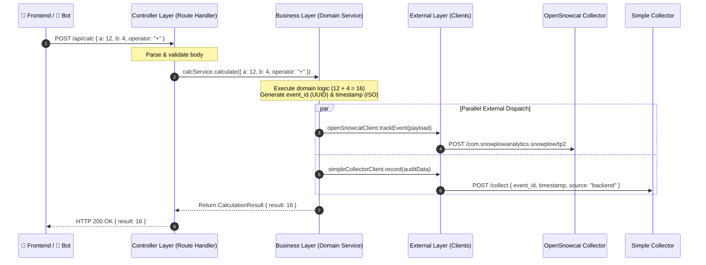

# Module 3: Backend Producer (API Service)

## 1. Overview
The **Backend Producer** is a server-side web application built with **Next.js** running on **Node.js 26**. It exposes the API endpoints required by the **Frontend Application** and the **Test Bot**.

For every processed request, the Backend Producer:
1. Executes the business logic (calculating, timezone formatting, excuse generation, dice rolling).
2. Generates an `event_id` (UUIDv4) and precise `timestamp`.
3. Emits an official OpenSnowcat server-side tracking event to the OpenSnowcat Stream Collector.
4. Simultaneously sends an audit record to the **Simple Collector** (`POST /collect` with `source: "backend"`).
5. Returns the response to the caller.

---

## 2. Layered Architecture & Dependency Rules

The application strictly enforces a **3-tier architectural separation**:

```
┌────────────────────────────────────────────────────────────────────────┐
│                        BACKEND ARCHITECTURE                            │
│                                                                        │
│   ┌──────────────────────────────────────────────────────────────┐     │
│   │ 1. CONTROLLER LAYER                                          │     │
│   │    - Next.js Route Handlers (app/api/.../route.ts)           │     │
│   │    - Parses & validates HTTP Request Body & Query Params     │     │
│   │    - Returns HTTP Response (Status codes & JSON)             │     │
│   │    - RULE: ONLY calls the Business Layer                     │     │
│   └──────────────────────────────┬───────────────────────────────┘     │
│                                  │ calls                               │
│                                  ▼                                     │
│   ┌──────────────────────────────────────────────────────────────┐     │
│   │ 2. BUSINESS LAYER                                            │     │
│   │    - Domain entities, value objects, and business rules      │     │
│   │    - Services (CalcService, TimestampService, ExcuseService) │     │
│   │    - Generates event_id and timestamp                        │     │
│   │    - RULE: ONLY layer permitted to call External services    │     │
│   └──────────────────────────────┬───────────────────────────────┘     │
│                                  │ calls                               │
│                                  ▼                                     │
│   ┌──────────────────────────────────────────────────────────────┐     │
│   │ 3. EXTERNAL LAYER                                            │     │
│   │    - External HTTP clients & service adapters                │     │
│   │    - OpenSnowcat Collector Client (/tp2)                     │     │
│   │    - Simple Collector Client (/collect)                      │     │
│   │    - RULE: Does not call Business or Controller              │     │
│   └──────────────────────────────────────────────────────────────┘     │
└────────────────────────────────────────────────────────────────────────┘
```

### Strict Enforcement Rules:
1. **Controller $\rightarrow$ Business ONLY:** Controllers handle HTTP requests and delegate directly to Business services. Controllers **must never** import or call the External layer directly.
2. **Business $\rightarrow$ External ONLY:** Only Business services are allowed to invoke External service clients (OpenSnowcat and Simple Collector).
3. **No Inverted Dependencies:** The External layer has no knowledge of Controllers or Business services.

---

## 3. Interaction Flow



---

## 4. Directory & Code Structure

The project structure cleanly isolates the 3 layers, adopting **The Canonical Next.js Pattern** where each API route colocates its Zod validation schema (`schema.ts`) right beside its route handler (`route.ts`):

```
apps/backend-producer/
├── package.json
├── tsconfig.json
├── next.config.ts
├── Dockerfile
├── src/
│   ├── app/
│   │   └── api/                            # 1. CONTROLLER LAYER (Next.js Route Handlers + Zod DTOs)
│   │       ├── calc/
│   │       │   ├── schema.ts               # Zod Request Schema & Inferred Types
│   │       │   └── route.ts                # Controller for POST /api/calc
│   │       ├── timestamp/
│   │       │   ├── schema.ts               # Zod Request Schema & Inferred Types
│   │       │   └── route.ts                # Controller for POST /api/timestamp
│   │       ├── daily-excuse/
│   │       │   └── route.ts                # Controller for GET /api/daily-excuse
│   │       ├── dice/
│   │       │   ├── schema.ts               # Zod Request Schema & Inferred Types
│   │       │   └── route.ts                # Controller for POST /api/dice
│   │       ├── batch/
│   │       │   ├── schema.ts               # Zod Request Schema & Inferred Types
│   │       │   └── route.ts                # Controller for POST /api/batch
│   │       └── health/
│   │           └── route.ts                # Controller for GET /api/health
│   │
│   ├── business/                           # 2. BUSINESS LAYER (Domain & Services)
│   │   ├── domain/                         # Domain Entities, Value Objects & Models
│   │   │   ├── calculation.ts              # Domain rules, operator logic, calculation models
│   │   │   ├── timestamp-info.ts           # Timezone validations & formatting models
│   │   │   ├── excuse.ts                   # Excuse entity and quote pool
│   │   │   └── dice-roll.ts                # Dice types (d4, d6, d20) and roll models
│   │   │
│   │   └── services/                       # Business Domain Services
│   │       ├── calc.service.ts             # Performs arithmetic & triggers tracking
│   │       ├── timestamp.service.ts        # Formats location time & triggers tracking
│   │       ├── excuse.service.ts           # Selects excuses & triggers tracking
│   │       ├── dice.service.ts             # Emulates dice rolls & triggers tracking
│   │       └── batch.service.ts            # Orchestrates bulk event emissions
│   │
│   └── external/                           # 3. EXTERNAL LAYER (Third-Party Clients)
│       ├── opensnowcat.client.ts           # Client for OpenSnowcat Stream Collector (/tp2)
│       └── simple-collector.client.ts      # Client for Simple Collector audit endpoint (/collect)
└── tests/
    ├── unit/                               # 1:1 Unit tests for controllers, business & domain
    └── integration/                        # Full API flow tests (only external clients mocked)
```

---

## 5. Layer Specifications & Implementation

### 5.1 Controller Layer: Schema Objects (DTOs) vs. Domain Objects

The API boundary strictly distinguishes between **Schema Objects** and **Domain Objects**:
- **Schema Objects (`schema.ts`):** Represent the public HTTP contract. Every endpoint defines both a **`RequestSchema`** (validating input) and a **`ResponseSchema`** (defining the public output shape). The endpoint **always returns a Schema Object** in the HTTP body.
- **Domain Objects (`src/business/domain/`):** Represent internal business entities, rules, and calculations. Domain objects are internal to the Business layer and are **never exposed directly over the network**.
- **Mapping:** The Controller invokes the Business service, receives a Domain Object, and maps it into the public `ResponseSchema` object.

```
Request JSON ──> [RequestSchema.safeParse] ──> Controller ──> Business (operates on Domain Object)
                                                                 │
Response JSON <── [ResponseSchema] <── Controller <── Domain Object returned
```

---

#### Example 1: `src/app/api/calc/schema.ts` (Colocated Request & Response Schemas)
```typescript
import { z } from 'zod';

// 1. Request Schema (Validates incoming HTTP request body)
export const CalcRequestSchema = z.object({
  a: z.number({ required_error: "'a' is required and must be a number" }),
  b: z.number({ required_error: "'b' is required and must be a number" }),
  operator: z.enum(['+', '-', '*', '/'], {
    errorMap: () => ({ message: "Operator must be one of: '+', '-', '*', '/'" })
  })
});
export type CalcRequestBody = z.infer<typeof CalcRequestSchema>;

// 2. Response Schema (Public API contract guaranteed by the endpoint)
export const CalcResponseSchema = z.object({
  result: z.number()
});
export type CalcResponseBody = z.infer<typeof CalcResponseSchema>;
```

#### Example 2: `src/app/api/calc/route.ts` (Controller Handler)
```typescript
import { NextRequest, NextResponse } from 'next/server';
import { CalcRequestSchema, CalcResponseBody } from './schema';
import { calcService } from '@/business/services/calc.service';

export async function POST(req: NextRequest) {
  try {
    // 1. Read raw body
    const rawBody = await req.json();

    // 2. Validate input using RequestSchema
    const validation = CalcRequestSchema.safeParse(rawBody);
    if (!validation.success) {
      return NextResponse.json(
        { errors: validation.error.flatten().fieldErrors },
        { status: 400 }
      );
    }

    // 3. Delegate to Business Layer (receives internal Domain Object)
    const domainCalculation = await calcService.calculate(validation.data);

    // 4. Map Domain Object to public Response Schema Object
    const responsePayload: CalcResponseBody = {
      result: domainCalculation.result
    };

    // 5. Return typed Schema Object
    return NextResponse.json(responsePayload, { status: 200 });

  } catch (error: any) {
    return NextResponse.json(
      { error: 'Internal Server Error', message: error.message },
      { status: 500 }
    );
  }
}
```

---

#### Schemas for All Other Service Endpoints:

#### 1. Location Timestamp (`src/app/api/timestamp/schema.ts`)
```typescript
import { z } from 'zod';

export const TimestampRequestSchema = z.object({
  timezone: z.string().default('UTC')
});
export type TimestampRequestBody = z.infer<typeof TimestampRequestSchema>;

export const TimestampResponseSchema = z.object({
  timestamp_iso: z.string(),
  formatted_local: z.string(),
  timezone: z.string()
});
export type TimestampResponseBody = z.infer<typeof TimestampResponseSchema>;
```

#### 2. Daily Excuse (`src/app/api/daily-excuse/schema.ts`)
```typescript
import { z } from 'zod';

// GET endpoint (no request body)
export const DailyExcuseResponseSchema = z.object({
  id: z.number(),
  excuse: z.string()
});
export type DailyExcuseResponseBody = z.infer<typeof DailyExcuseResponseSchema>;
```

#### 3. Dice Emulator (`src/app/api/dice/schema.ts`)
```typescript
import { z } from 'zod';

export const DiceRequestSchema = z.object({
  count: z.number().int().min(1).max(10).default(2),
  sides: z.enum(['d4', 'd6', 'd8', 'd10', 'd12', 'd20', 'd100']).default('d6')
});
export type DiceRequestBody = z.infer<typeof DiceRequestSchema>;

export const DiceResponseSchema = z.object({
  rolls: z.array(z.number()),
  total: z.number()
});
export type DiceResponseBody = z.infer<typeof DiceResponseSchema>;
```

#### 4. Batch Simulation (`src/app/api/batch/schema.ts`)
```typescript
import { z } from 'zod';

export const BatchRequestSchema = z.object({
  count: z.number().int().min(1).max(1000).default(50)
});
export type BatchRequestBody = z.infer<typeof BatchRequestSchema>;

export const BatchResponseSchema = z.object({
  status: z.literal('completed'),
  events_emitted: z.number()
});
export type BatchResponseBody = z.infer<typeof BatchResponseSchema>;
```

---

### 5.2 Business Layer (`src/business/`)
- **Responsibilities:**
  - Implements all application domain logic (mathematical operations, date/timezone math, random generators).
  - Enforces domain constraints (e.g., division by zero prevention, dice count limits between 1 and 10).
  - Uses and returns internal **Domain Entities** (`Calculation`, `TimeLocation`, `Excuse`, `DiceRoll`).
  - Generates unique tracking metadata:
    ```typescript
    const eventId = crypto.randomUUID();
    const timestamp = new Date().toISOString();
    ```
  - **Invokes External Services:** Dispatches tracking payloads to OpenSnowcat client and audit entries to Simple Collector client.

#### Domain Object Example (`src/business/domain/calculation.ts`):
```typescript
export class Calculation {
  constructor(
    public readonly a: number,
    public readonly b: number,
    public readonly operator: string,
    public readonly result: number,
    public readonly calculatedAt: Date = new Date()
  ) {}

  public isDivision(): boolean {
    return this.operator === '/';
  }
}
```

#### Business Service Example (`src/business/services/calc.service.ts`):
```typescript
import { openSnowcatClient } from '@/external/opensnowcat.client';
import { simpleCollectorClient } from '@/external/simple-collector.client';
import { Calculation } from '@/business/domain/calculation';
import { CalcRequestBody } from '@/app/api/calc/schema';

export class CalcService {
  async calculate(params: CalcRequestBody): Promise<Calculation> {
    // 1. Business Logic
    let result: number;
    switch (params.operator) {
      case '+': result = params.a + params.b; break;
      case '-': result = params.a - params.b; break;
      case '*': result = params.a * params.b; break;
      case '/':
        if (params.b === 0) throw new Error('Division by zero');
        result = params.a / params.b;
        break;
      default:
        throw new Error(`Unsupported operator: ${params.operator}`);
    }

    // 2. Tracking Identifiers
    const eventId = crypto.randomUUID();
    const timestamp = new Date().toISOString();

    // 3. STRICT RULE: Business calls External Layer
    await Promise.all([
      openSnowcatClient.emitStructuredEvent({
        category: 'backend_service',
        action: 'calculate',
        label: params.operator,
        property: `${params.a}${params.operator}${params.b}`,
        value: result,
        eventId,
        timestamp
      }),
      simpleCollectorClient.record({
        event_id: eventId,
        timestamp,
        source: 'backend',
        event_type: 'backend_api'
      })
    ]);

    // 4. Returns the internal Domain Entity to Controller
    return new Calculation(params.a, params.b, params.operator, result);
}

export const calcService = new CalcService();
```

---

### 5.3 External Layer (`src/external/`)
- **Responsibilities:**
  - Manages network communication and HTTP headers with outside services.
  - Formats payloads according to external contracts.
  - Implements timeouts and resilient error logging so external tracking failures do not crash business execution.
- **Clients:**
  1. **`openSnowcat.client.ts`:**
     - Endpoint: `POST ${OPENSNOWCAT_COLLECTOR_URL}/com.snowplowanalytics.snowplow/tp2`
     - Formats standard OpenSnowcat/Snowplow collector payload envelope (`iglu:com.snowplowanalytics.snowplow/payload_data/jsonschema/1-0-4`).
  2. **`simpleCollector.client.ts`:**
     - Endpoint: `POST ${SIMPLE_COLLECTOR_URL}/collect`
     - Body: `{ event_id, timestamp, source: "backend", event_type: "backend_api" }`

---

## 6. API Endpoints Reference

### 6.1 Service Endpoints

#### `POST /api/calc`
- **Controller:** `src/app/api/calc/route.ts`
- **Request Body:** `{ "a": 12, "b": 4, "operator": "+" }`
- **Response:**
  ```json
  { "result": 16 }
  ```

#### `POST /api/timestamp`
- **Controller:** `src/app/api/timestamp/route.ts`
- **Request Body:** `{ "timezone": "America/Sao_Paulo" }`
- **Response:**
  ```json
  {
    "timestamp_iso": "2026-10-11T14:30:00.123Z",
    "formatted_local": "11/10/2026, 11:30:00",
    "timezone": "America/Sao_Paulo"
  }
  ```

#### `GET /api/daily-excuse`
- **Controller:** `src/app/api/daily-excuse/route.ts`
- **Response:**
  ```json
  {
    "id": 14,
    "excuse": "My branch has 87 merge conflicts and git is currently in a detached HEAD existential crisis."
  }
  ```

#### `POST /api/dice`
- **Controller:** `src/app/api/dice/route.ts`
- **Request Body:** `{ "count": 2, "sides": 6 }`
- **Response:**
  ```json
  {
    "rolls": [3, 5],
    "total": 8
  }
  ```

---

### 6.2 System & Testing Endpoints

#### `POST /api/batch`
- **Controller:** `src/app/api/batch/route.ts`
- **Request Body:** `{ "count": 50 }`
- **Behavior:** Generates 50 events in a loop or bulk payload, emitting 50 tracking events to OpenSnowcat and 50 audit pings to Simple Collector.

#### `GET /api/health`
- **Controller:** `src/app/api/health/route.ts`
- **Response:** `{ "status": "ok", "service": "backend-producer" }`

---

## 7. Configuration & Technical Stack

- **Runtime:** **Node.js 26**
- **Framework:** **Next.js 15+** (App Router Route Handlers)
- **Port:** `4000`

### Dependencies (`package.json` snippet)
```json
{
  "name": "opensnowcat-backend",
  "version": "1.0.0",
  "type": "module",
  "engines": {
    "node": ">=26.0.0"
  },
  "scripts": {
    "dev": "next dev -p 4000",
    "build": "next build",
    "start": "next start -p 4000",
    "test": "vitest run",
    "test:unit": "vitest run src/",
    "test:integration": "vitest run tests/integration/",
    "test:watch": "vitest",
    "test:coverage": "vitest run --coverage"
  },
  "dependencies": {
    "next": "^15.1.0",
    "react": "^19.0.0",
    "react-dom": "^19.0.0",
    "zod": "^3.24.0"
  },
  "devDependencies": {
    "vitest": "^2.1.0"
  }
}
```

### Environment Variables
| Variable | Default | Description |
|---|---|---|
| `PORT` | `4000` | Port for Next.js server. |
| `OPENSNOWCAT_COLLECTOR_URL` | `http://localhost:8080` | Target OpenSnowcat Stream Collector endpoint. |
| `SIMPLE_COLLECTOR_URL` | `http://localhost:5000` | Simple Collector audit service endpoint. |

### 7.3 Dockerfile Specification (`apps/backend-producer/Dockerfile`)

```dockerfile
FROM node:26-alpine AS builder
WORKDIR /app
COPY package*.json tsconfig.json next.config.ts ./
RUN npm ci
COPY src ./src
RUN npm run build

FROM node:26-alpine AS runner
WORKDIR /app
ENV NODE_ENV=production
ENV PORT=4000
ENV HOSTNAME="0.0.0.0"

COPY --from=builder /app/package.json ./package.json
COPY --from=builder /app/.next/standalone ./
COPY --from=builder /app/.next/static ./.next/static

USER node
EXPOSE 4000

HEALTHCHECK --interval=5s --timeout=3s --retries=5 --start-period=5s \
  CMD wget -qO- http://localhost:4000/api/health || exit 1

CMD ["node", "server.js"]
```

---

## 8. Testing Strategy: Unit Tests & Integration Tests

The Backend Producer enforces two distinct testing tiers:
1. **Unit Tests (1:1 Companion Files):** Every source file has its own unit test file testing its logic in complete isolation with mock dependencies.
2. **Integration Tests:** Simulates all layers working together (Controller $\rightarrow$ Business $\rightarrow$ External) and validates the end-to-end API response and external dispatch side effects.

```
┌────────────────────────────────────────────────────────────────────────┐
│                        BACKEND TESTING TIERS                           │
│                                                                        │
│   ┌──────────────────────────────────────────────────────────────┐     │
│   │ 1. UNIT TESTS (File-by-File Isolation)                       │     │
│   │    - Controller Tests (route.test.ts)                        │     │
│   │      → Mocks Business Layer                                  │     │
│   │      → Tests Zod validation (HTTP 400) & HTTP status codes   │     │
│   │    - Service Tests (*.service.test.ts)                       │     │
│   │      → Mocks External Clients                                │     │
│   │      → Tests domain math, rules & event_id generation        │     │
│   │    - Domain Tests (*.test.ts)                                │     │
│   │      → Tests pure entity rules & invariants                  │     │
│   │    - Client Tests (*.client.test.ts)                         │     │
│   │      → Tests payload formatting & HTTP options               │     │
│   └──────────────────────────────────────────────────────────────┘     │
│                                                                        │
│   ┌──────────────────────────────────────────────────────────────┐     │
│   │ 2. INTEGRATION TESTS (Full Lifecycle Simulation)             │     │
│   │    - Tests actual NextRequest → Route Handler                │     │
│   │    - Executes real Business Services & Domain logic          │     │
│   │    - Validates HTTP response body against ResponseSchema     │     │
│   │    - Intercepts external network to verify OpenSnowcat &     │     │
│   │      Simple Collector received matching event_id & timestamp │     │
│   └──────────────────────────────────────────────────────────────┘     │
└────────────────────────────────────────────────────────────────────────┘
```

---

### 8.1 Unit Tests (1:1 File Mapping)

Every file in the repository has a companion `*.test.ts` file colocated in the same directory:

| Source File | Companion Unit Test File | What It Tests |
|---|---|---|
| `src/app/api/calc/route.ts` | `src/app/api/calc/route.test.ts` | Request parsing, Zod 400 errors, Business delegation, Response mapping. |
| `src/app/api/timestamp/route.ts` | `src/app/api/timestamp/route.test.ts` | Timezone input validation, 200 responses, error handling. |
| `src/app/api/daily-excuse/route.ts` | `src/app/api/daily-excuse/route.test.ts` | GET request handling, excuse response format. |
| `src/app/api/dice/route.ts` | `src/app/api/dice/route.test.ts` | Dice count (1–10) bounds, sides enum validation, 400 errors. |
| `src/app/api/batch/route.ts` | `src/app/api/batch/route.test.ts` | Count parameter validation, batch execution delegation. |
| `src/business/services/calc.service.ts` | `src/business/services/calc.service.test.ts` | Math operations (`+`, `-`, `*`, `/`), division by zero error, event metadata. |
| `src/business/services/timestamp.service.ts`| `src/business/services/timestamp.service.test.ts`| Timezone calculations, formatted string output. |
| `src/business/services/excuse.service.ts` | `src/business/services/excuse.service.test.ts` | Random selection, non-empty text, pool coverage. |
| `src/business/services/dice.service.ts` | `src/business/services/dice.service.test.ts` | Random range bounds per die side, total sum math. |
| `src/business/domain/calculation.ts` | `src/business/domain/calculation.test.ts` | Entity creation, properties immutability, helper methods. |
| `src/external/opensnowcat.client.ts` | `src/external/opensnowcat.client.test.ts` | Snowplow `/tp2` envelope formatting, timeout handling. |
| `src/external/simple-collector.client.ts`| `src/external/simple-collector.client.test.ts`| Audit payload structure, error recovery if collector is offline. |

#### Example Controller Unit Test (`src/app/api/calc/route.test.ts`):
```typescript
import { describe, it, expect, vi, beforeEach } from 'vitest';
import { NextRequest } from 'next/server';
import { POST } from './route';
import { calcService } from '@/business/services/calc.service';
import { Calculation } from '@/business/domain/calculation';

// 1. Mock Business Layer (isolation)
vi.mock('@/business/services/calc.service', () => ({
  calcService: {
    calculate: vi.fn()
  }
}));

describe('Calc Controller (POST /api/calc)', () => {
  beforeEach(() => {
    vi.clearAllMocks();
  });

  it('returns 400 Bad Request when request body fails Zod schema', async () => {
    const req = new NextRequest('http://localhost:4000/api/calc', {
      method: 'POST',
      body: JSON.stringify({ a: 'invalid_number', b: 5, operator: '+' })
    });

    const res = await POST(req);
    expect(res.status).toBe(400);

    const data = await res.json();
    expect(data.errors).toHaveProperty('a');
    expect(calcService.calculate).not.toHaveBeenCalled();
  });

  it('delegates valid body to Business Service and returns ResponseSchema (HTTP 200)', async () => {
    // Mock Business returning domain object
    vi.mocked(calcService.calculate).mockResolvedValueOnce(
      new Calculation(10, 5, '+', 15)
    );

    const req = new NextRequest('http://localhost:4000/api/calc', {
      method: 'POST',
      body: JSON.stringify({ a: 10, b: 5, operator: '+' })
    });

    const res = await POST(req);
    expect(res.status).toBe(200);

    const data = await res.json();
    // Validates clean ResponseSchema (no internal event_id leaked)
    expect(data).toEqual({ result: 15 });
    expect(calcService.calculate).toHaveBeenCalledWith({ a: 10, b: 5, operator: '+' });
  });
});
```

#### Example Business Service Unit Test (`src/business/services/calc.service.test.ts`):
```typescript
import { describe, it, expect, vi, beforeEach } from 'vitest';
import { CalcService } from './calc.service';
import { openSnowcatClient } from '@/external/opensnowcat.client';
import { simpleCollectorClient } from '@/external/simple-collector.client';

// Mock External Layer (isolation)
vi.mock('@/external/opensnowcat.client', () => ({
  openSnowcatClient: { emitStructuredEvent: vi.fn().mockResolvedValue(true) }
}));
vi.mock('@/external/simple-collector.client', () => ({
  simpleCollectorClient: { record: vi.fn().mockResolvedValue(true) }
}));

describe('CalcService Business Logic', () => {
  let service: CalcService;

  beforeEach(() => {
    vi.clearAllMocks();
    service = new CalcService();
  });

  it('performs arithmetic, generates event metadata, and notifies external clients', async () => {
    const domainCalc = await service.calculate({ a: 12, b: 4, operator: '+' });

    expect(domainCalc.result).toBe(16);

    // Verify OpenSnowcat client was called with structured event
    expect(openSnowcatClient.emitStructuredEvent).toHaveBeenCalledWith(
      expect.objectContaining({
        category: 'backend_service',
        action: 'calculate',
        value: 16,
        eventId: expect.any(String),
        timestamp: expect.any(String)
      })
    );

    // Verify Simple Collector client was called with matching event_id
    expect(simpleCollectorClient.record).toHaveBeenCalledWith(
      expect.objectContaining({
        event_id: expect.any(String),
        timestamp: expect.any(String),
        source: 'backend',
        event_type: 'backend_api'
      })
    );
  });

  it('throws domain error on division by zero', async () => {
    await expect(service.calculate({ a: 10, b: 0, operator: '/' }))
      .rejects.toThrow('Division by zero');

    // External calls must not be made if business logic fails
    expect(openSnowcatClient.emitStructuredEvent).not.toHaveBeenCalled();
    expect(simpleCollectorClient.record).not.toHaveBeenCalled();
  });
});
```

---

### 8.2 Integration Tests (Full Request Simulation)

> **Strict Integration Testing Rule: ONLY External Services Are Mocked.**
> - **Controller Layer:** 100% REAL (executes actual Next.js `POST(req)` handler).
> - **Zod Validation:** 100% REAL (runs live `safeParse()` against the request body).
> - **Business Layer:** 100% REAL (runs real business service calculations and domain rules).
> - **Domain Entities:** 100% REAL (creates real domain objects).
> - **External Services:** **THE ONLY MOCKED LAYER** (`openSnowcatClient` and `simpleCollectorClient`).

Integration tests live in `tests/integration/` and verify that when a real request enters the API, all internal layers collaborate correctly, produce the expected response, and trigger the appropriate external service calls.

#### Example Integration Test (`tests/integration/api-calc.integration.test.ts`):
```typescript
import { describe, it, expect, vi, beforeEach } from 'vitest';
import { NextRequest } from 'next/server';
import { POST } from '@/app/api/calc/route';
import { CalcResponseSchema } from '@/app/api/calc/schema';
import { openSnowcatClient } from '@/external/opensnowcat.client';
import { simpleCollectorClient } from '@/external/simple-collector.client';

// STRICT RULE: ONLY External services are mocked in integration tests!
// Controller, Business services, and Domain entities are 100% real.
vi.mock('@/external/opensnowcat.client', () => ({
  openSnowcatClient: {
    emitStructuredEvent: vi.fn().mockResolvedValue(true)
  }
}));

vi.mock('@/external/simple-collector.client', () => ({
  simpleCollectorClient: {
    record: vi.fn().mockResolvedValue(true)
  }
}));

describe('Integration Test: POST /api/calc Full Flow', () => {
  beforeEach(() => {
    vi.clearAllMocks();
  });

  it('runs real Controller and real Business logic, mocking ONLY External services', async () => {
    // 1. Dispatch real HTTP Request into Controller
    const req = new NextRequest('http://localhost:4000/api/calc', {
      method: 'POST',
      headers: { 'Content-Type': 'application/json' },
      body: JSON.stringify({ a: 50, b: 10, operator: '-' })
    });

    // 2. Execute real Route Handler (Controller calls real Business Service)
    const response = await POST(req);

    // 3. Validate HTTP Status
    expect(response.status).toBe(200);

    // 4. Validate API Response against Zod ResponseSchema
    const responseBody = await response.json();
    const schemaValidation = CalcResponseSchema.safeParse(responseBody);
    expect(schemaValidation.success).toBe(true);
    expect(responseBody).toEqual({ result: 40 });

    // 5. Verify the real Business Service invoked the External OpenSnowcat Client
    expect(openSnowcatClient.emitStructuredEvent).toHaveBeenCalledTimes(1);
    expect(openSnowcatClient.emitStructuredEvent).toHaveBeenCalledWith(
      expect.objectContaining({
        category: 'backend_service',
        action: 'calculate',
        value: 40,
        eventId: expect.any(String),
        timestamp: expect.any(String)
      })
    );

    // 6. Verify the real Business Service invoked the External Simple Collector Client
    expect(simpleCollectorClient.record).toHaveBeenCalledTimes(1);
    expect(simpleCollectorClient.record).toHaveBeenCalledWith(
      expect.objectContaining({
        event_id: expect.any(String),
        timestamp: expect.any(String),
        source: 'backend',
        event_type: 'backend_api'
      })
    );

    // 7. Verify deterministic parity: event_id passed to both external services matches
    const openSnowcatCall = vi.mocked(openSnowcatClient.emitStructuredEvent).mock.calls[0][0];
    const simpleCollectorCall = vi.mocked(simpleCollectorClient.record).mock.calls[0][0];
    expect(openSnowcatCall.eventId).toBe(simpleCollectorCall.event_id);
  });
});
```

---

### 8.3 Test Execution Commands

```bash
# 1. Run all unit tests across all files
npm run test:unit

# 2. Run all integration tests
npm run test:integration

# 3. Run entire test suite (unit + integration)
npm test

# 4. Generate coverage report (verifies 1:1 file test coverage)
npm run test:coverage
```
