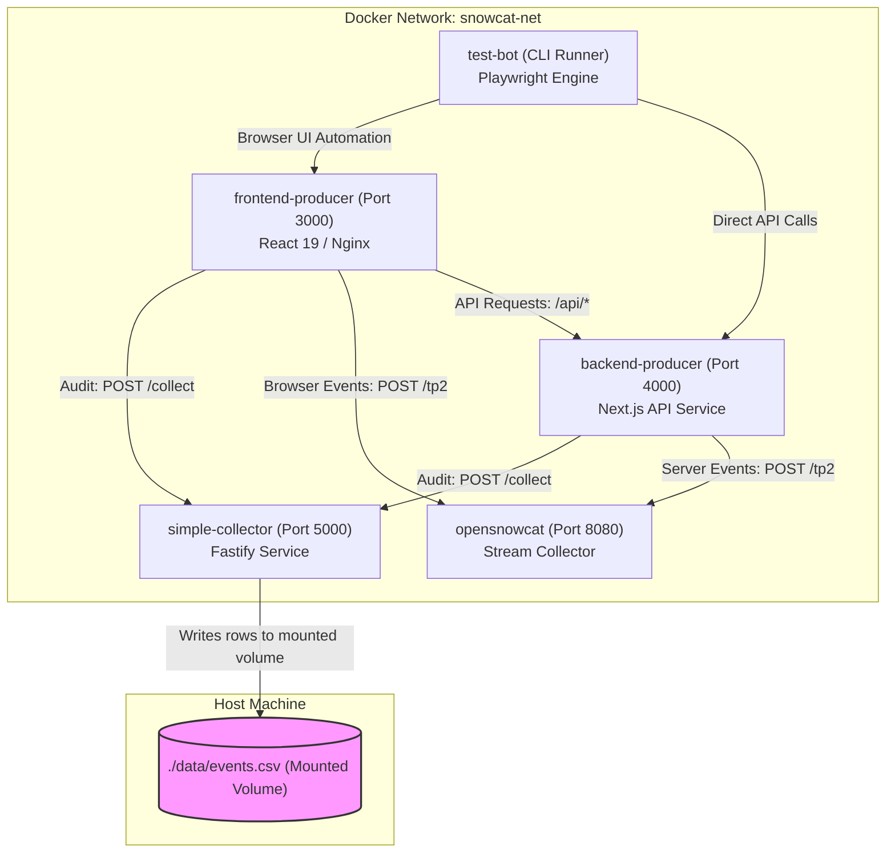

# Multi-Service Docker Compose Orchestration (`docker-compose.md`)

## 1. Overview
This specification details the multi-container orchestration architecture for **`opensnowcat-events-test`**. All 4 application services (`simple-collector`, `backend-producer`, `frontend-producer`, `test-bot`) are coordinated on a shared Docker bridge network (`snowcat-net`) using health check dependency sequencing.

---

## 2. Container Network & Volume Topology



---

## 3. `docker-compose.yml` Specification

The orchestration file is the root [`docker-compose.yml`](../../docker-compose.yml), which is the source of truth for images, ports, environment variables, healthchecks and `depends_on` conditions. It is not duplicated here.

| Service | Build / Image | Host Port | Notes |
|---|---|---|---|
| `opensnowcat` | `ghcr.io/opensnowcat/opensnowcat-collector-stdout` | 8080 | Local stream collector (`POST /tp2`). |
| `simple-collector` | `apps/simple-collector` | 5000 | Writes `./data/events.csv` via host volume. |
| `backend-producer` | `apps/backend-producer` | 4000 | Waits for `simple-collector` healthy. |
| `frontend-producer` | `apps/frontend-producer` | 3000 | Waits for `backend-producer` healthy. |
| `test-bot` | `apps/test-bot` (profile `full-test`) | none | CLI runner; starts after all services are healthy. |

---

## 4. Startup Sequencing & Health Checks

To prevent race conditions during startup:
1. **`simple-collector`** starts first and exposes `GET /health`.
2. **`backend-producer`** waits for `simple-collector` to report healthy before initializing its outbound HTTP clients.
3. **`frontend-producer`** waits for `backend-producer` to be healthy before accepting browser requests.
4. **`test-bot`** only launches once all services report healthy and are ready to receive load.

### 4.1 Container Network Routing & Request Rewriting
- **Host Browser vs Container Traffic:** The `frontend-producer` is compiled with browser-facing defaults (`VITE_BACKEND_URL=http://localhost:4000`, `VITE_SIMPLE_COLLECTOR_URL=http://localhost:5000`), allowing host browsers to communicate via exposed host ports (`3000`, `4000`, `5000`).
- **Containerized Playwright Execution:** When `test-bot` navigates to `http://frontend-producer:3000` from within `snowcat-net`, in-browser client calls to `localhost:*` would normally resolve to the `test-bot` container itself and fail.
- **Resolution Strategy:** Rather than requiring host networking (which is non-portable across Docker on Linux, macOS, and CI), the `test-bot` configures Playwright route interception (`context.route`) to dynamically rewrite in-page `http://localhost:4000` and `http://localhost:5000` requests to `BACKEND_URL` (`http://backend-producer:4000`) and `SIMPLE_COLLECTOR_URL` (`http://simple-collector:5000`).

---

## 5. Host Volume & Data Persistence

The Simple Collector mounts the host volume `./data` to `/app/data`:
- When the Test Bot executes, `events.csv` is written inside the container at `/app/data/events.csv`.
- This maps directly to `./data/events.csv` on the host machine.
- Stopping or removing containers (`docker compose down`) preserves the generated CSV on the host disk for downstream event loss analysis.

---

## 6. Execution Profiles & Commands

### 6.1 Manual Development / Browser Inspection
Starts `simple-collector`, `backend-producer`, and `frontend-producer`:
```bash
docker compose up --build
```
- Frontend UI: `http://localhost:3000`
- Backend API: `http://localhost:4000/api/health`
- Simple Collector: `http://localhost:5000/health`

### 6.2 Full Automated Test Run
Starts all services, waits for health checks, and triggers the Test Bot automatically:
```bash
docker compose --profile full-test up --build
```

### 6.3 On-Demand Bot Run with Custom Parameters
```bash
docker compose run --rm test-bot npx tsx src/index.ts \
  --frontend-url http://frontend-producer:3000 \
  --backend-url http://backend-producer:4000 \
  --iterations 500 \
  --concurrency 5 \
  --delay-ms 20
```

### 6.4 Teardown
```bash
docker compose down
```

---

## 7. Cross-Reference Links

- **Container Standards & Service Dockerfiles:** [`docker.md`](docker.md)
- **Module 1 (Test Bot):** [`test-bot.md`](test-bot.md)
- **Module 2 (Frontend Producer):** [`frontend-producer.md`](frontend-producer.md)
- **Module 3 (Backend Producer):** [`backend-producer.md`](backend-producer.md)
- **Module 4 (Simple Collector):** [`simple-collector.md`](simple-collector.md)
