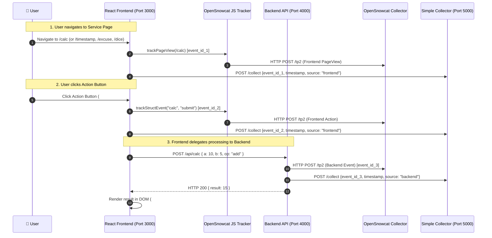

# Module 2: Frontend Producer (Web Application)

## 1. Overview
The **Frontend Producer** is a web application built with **React** running on **Node.js 26**. It embeds the [OpenSnowcat / Snowplow JavaScript Tracker](https://github.com/snowplow/snowplow-javascript-tracker) and provides a user-facing dashboard with 5 distinct pages.

### Key Architectural Constraint:
**All services must be processed by the Backend Producer API.** The browser client never computes calculations, timestamps, excuses, or dice rolls locally. Each service page is an interactive interface that invokes a backend endpoint.

On every user interaction:
1. **Page Navigation:** Emits a `trackPageView` event to OpenSnowcat and reports `{event_id, timestamp, source: "frontend"}` to the Simple Collector.
2. **Service Action:** Emits a `trackStructEvent` and/or `trackSelfDescribingEvent` to OpenSnowcat, reports `{event_id, timestamp, source: "frontend"}` to the Simple Collector, and invokes the Backend Producer API.
3. **Backend Processing:** The Backend executes the service logic, emits its own backend event to OpenSnowcat, reports `{event_id, timestamp, source: "backend"}` to the Simple Collector, and returns the response to the frontend.

---

## 2. Architecture & Interaction Flow



---

## 3. Technical Stack & Dependencies

- **Runtime:** **Node.js 26**
- **Framework:** **React 19** with **Vite** (for fast development & build)
- **Routing:** **React Router v7 / v6** (Client-side routing across 5 pages)
- **Tracker SDK:** `@snowplow/browser-tracker`
- **Port:** `3000`

### Dependencies (`package.json` snippet)
```json
{
  "name": "opensnowcat-frontend",
  "version": "1.0.0",
  "type": "module",
  "engines": {
    "node": ">=26.0.0"
  },
  "scripts": {
    "dev": "vite",
    "build": "vite build",
    "test": "vitest run",
    "test:watch": "vitest",
    "test:coverage": "vitest run --coverage"
  },
  "dependencies": {
    "react": "^19.0.0",
    "react-dom": "^19.0.0",
    "react-router-dom": "^7.0.0",
    "@snowplow/browser-tracker": "^3.12.0"
  },
  "devDependencies": {
    "@vitejs/plugin-react": "^4.3.0",
    "vite": "^6.0.0",
    "vitest": "^2.1.0",
    "@testing-library/react": "^16.1.0",
    "@testing-library/user-event": "^14.5.0",
    "jsdom": "^25.0.0"
  }
}
```

### 3.1 Directory Layout

```
apps/frontend-producer/
├── package.json
├── tsconfig.json
├── vite.config.ts
├── index.html
├── Dockerfile
├── src/
│   ├── main.tsx                     # Entrypoint & Router setup
│   ├── App.tsx                      # App layout & navigation header
│   ├── styles.css                   # Global responsive styling & themes
│   ├── vite-env.d.ts                # Vite environment typings
│   ├── config/                      # Environment variables & runtime config
│   │   └── env.ts                   # Centralized typed configuration
│   ├── pages/                       # 5 Application pages
│   │   ├── HomePage.tsx             # / (Dashboard & event counter)
│   │   ├── CalcPage.tsx             # /calc (Delegates to backend POST /api/calc)
│   │   ├── TimestampPage.tsx        # /timestamp (Delegates to backend POST /api/timestamp)
│   │   ├── ExcusePage.tsx           # /excuse (Delegates to backend GET /api/daily-excuse)
│   │   └── DicePage.tsx             # /dice (Delegates to backend POST /api/dice)
│   ├── tracker/                     # OpenSnowcat tracker & Simple Collector reporter
│   │   ├── snowcat.ts               # OpenSnowcat JS SDK initialization & lifecycle
│   │   ├── simple-collector.ts      # Audit HTTP ping (POST /collect)
│   │   └── event-emitter.ts         # Dual-emission orchestration & event mode state
│   └── services/                    # API client delegating to Backend Producer
│       └── backend-api.ts           # Fetch calls to backend (port 4000)
└── tests/
    ├── setup.ts                     # Vitest setup & DOM polyfills
    ├── main.test.tsx                # 1:1 Unit test for main.tsx entrypoint
    ├── App.test.tsx                 # 1:1 Unit test for App layout & header
    ├── config/                      # Configuration unit tests
    │   └── env.test.ts
    ├── pages/                       # 1:1 Page & Component tests
    │   ├── HomePage.test.tsx
    │   ├── CalcPage.test.tsx
    │   ├── TimestampPage.test.tsx
    │   ├── ExcusePage.test.tsx
    │   └── DicePage.test.tsx
    ├── services/                    # Backend API client unit tests
    │   └── backend-api.test.ts
    ├── tracker/                     # Tracking subsystem unit tests
    │   ├── snowcat.test.ts
    │   ├── simple-collector.test.ts
    │   └── event-emitter.test.ts
    └── integration/                 # End-to-end component integration tests
        ├── test-router.tsx
        ├── calc.integration.test.tsx
        ├── timestamp.integration.test.tsx
        ├── excuse.integration.test.tsx
        ├── dice.integration.test.tsx
        ├── mode-toggle.integration.test.tsx
        └── error-resilience.integration.test.tsx
```

### 3.2 Dockerfile Specification (`apps/frontend-producer/Dockerfile`)

```dockerfile
FROM node:26-alpine AS builder
WORKDIR /app
COPY package*.json tsconfig.json vite.config.ts index.html ./
RUN npm ci
COPY src ./src
ARG VITE_BACKEND_URL=http://localhost:4000
ARG VITE_SIMPLE_COLLECTOR_URL=http://localhost:5000
ARG VITE_OPENSNOWCAT_URL=http://localhost:8080
ENV VITE_BACKEND_URL=$VITE_BACKEND_URL
ENV VITE_SIMPLE_COLLECTOR_URL=$VITE_SIMPLE_COLLECTOR_URL
ENV VITE_OPENSNOWCAT_URL=$VITE_OPENSNOWCAT_URL
RUN npm run build

FROM nginx:alpine AS runner
COPY --from=builder /app/dist /usr/share/nginx/html

RUN echo 'server { \
    listen 3000; \
    location / { \
        root /usr/share/nginx/html; \
        index index.html index.htm; \
        try_files $uri $uri/ /index.html; \
    } \
}' > /etc/nginx/conf.d/default.conf

EXPOSE 3000
CMD ["nginx", "-g", "daemon off;"]
```

---

## 4. Pages & Service Specifications

The application consists of **5 pages**:

```
/                -> Home Page (Service Dashboard & Navigation)
├── /calc        -> Service 1: Simple Calculator
├── /timestamp   -> Service 2: Current Timestamp in My Location
├── /excuse      -> Service 3: Daily Standup Excuse Generator
└── /dice        -> Service 4: Dice Emulator
```

### Page 1: Home Page (`/`)
- **Purpose:** Central navigation hub linking to all 4 services.
- **Key Elements:**
  - Navigation links / cards to `/calc`, `/timestamp`, `/excuse`, and `/dice`.
  - Global event statistics counter (`#frontend-events-counter`) showing total events triggered in the session.
- **DOM Selectors for Bot:**
  - `#link-nav-home`
  - `#link-nav-calc`
  - `#link-nav-timestamp`
  - `#link-nav-excuse`
  - `#link-nav-dice`

---

### Page 2: Simple Calculator (`/calc`)
- **Purpose:** Arithmetic calculator that delegates computation to the backend.
- **Form Inputs & Action:**
  - Input A (`#calc-input-a`): Number
  - Operator select (`#calc-select-op`): `+`, `-`, `*`, `/`
  - Input B (`#calc-input-b`): Number
  - Submit Button (`#btn-calc-submit`): "Calculate"
- **Backend API Endpoint:** `POST /api/calc`
  - Request: `{ "a": 12, "b": 4, "operator": "+" }`
  - Response: `{ "result": 16 }`
- **Output Container:** `#calc-result` displays the returned value.

---

### Page 3: Current Timestamp in My Location (`/timestamp`)
- **Purpose:** Retrieves the current formatted timestamp and timezone for the user's location via the backend.
- **Form Inputs & Action:**
  - Automatically captures browser timezone: `Intl.DateTimeFormat().resolvedOptions().timeZone` (e.g., `"America/Sao_Paulo"`).
  - Optional timezone override input: `#timestamp-input-tz`.
  - Fetch Button (`#btn-timestamp-fetch`): "Get Location Timestamp"
- **Backend API Endpoint:** `POST /api/timestamp`
  - Request: `{ "timezone": "America/Sao_Paulo" }`
  - Response: `{ "timestamp_iso": "2026-10-11T14:30:00.000Z", "formatted_local": "11/10/2026, 11:30:00", "timezone": "America/Sao_Paulo" }`
- **Output Container:** `#timestamp-result` displays the formatted timestamp.

---

### Page 4: Daily Standup Excuse Generator (`/excuse`)
- **Purpose:** *"What excuse am I going to give today for not going to the daily?"* — generates humorous, developer-centric excuses for skipping the daily standup.
- **Form Inputs & Action:**
  - Generate Button (`#btn-generate-excuse`): "Get Daily Excuse"
- **Backend API Endpoint:** `GET /api/daily-excuse`
  - Response:
    ```json
    {
      "id": 42,
      "excuse": "My Docker container is eating 100% of my CPU and my mic won't unmute."
    }
    ```
- **Output Container:** `#excuse-result` displays the generated excuse.

---

### Page 5: Dice Emulator (`/dice`)
- **Purpose:** Generates random dice rolls calculated strictly on the backend.
- **Form Inputs & Action:**
  - Dice count input (`#dice-input-count`): Number of dice to roll (default: 2, min: 1, max: 10).
  - Dice sides select (`#dice-select-sides`): `d4`, `d6`, `d8`, `d10`, `d12`, `d20`, `d100` (default: `d6`).
  - Roll Button (`#btn-roll-dice`): "Roll Dice"
- **Backend API Endpoint:** `POST /api/dice`
  - Request: `{ "count": 2, "sides": "d6" }`
  - Response: `{ "rolls": [4, 6], "total": 10 }`
- **Output Container:** `#dice-result` displays individual rolls and the total sum.

---

## 5. Event Types Emitted by Frontend

The frontend is specifically designed to emit **both No-Schema (standard) and Self-Describing events**. This ensures the OpenSnowcat infrastructure is tested across both schema-independent ingestion and Iglu schema-resolution pipelines.

```
┌────────────────────────────────────────────────────────────────────────┐
│                        FRONTEND EVENT TYPES                            │
│                                                                        │
│   ┌────────────────────────────────┐   ┌───────────────────────────┐   │
│   │       NO-SCHEMA EVENTS         │   │  SELF-DESCRIBING EVENTS   │   │
│   │    (Standard / Out-of-the-box) │   │     (Iglu Schema-Based)   │   │
│   ├────────────────────────────────┤   ├───────────────────────────┤   │
│   │ • trackPageView(...)           │   │ • trackSelfDescribingEvent│   │
│   │   - URL, title, referrer       │   │   - calc_event/1-0-0      │   │
│   │ • trackStructEvent(...)        │   │   - timestamp_event/1-0-0 │   │
│   │   - category, action, label,   │   │   - excuse_event/1-0-0    │   │
│   │     property, value            │   │   - dice_event/1-0-0      │   │
│   └────────────────────────────────┘   └───────────────────────────┘   │
└────────────────────────────────────────────────────────────────────────┘
```

---

### 5.1 No-Schema Events (Standard)

These events do not require custom Iglu schema registration and are supported natively by OpenSnowcat:

#### 1. Page View Events (`trackPageView`)
Emitted on initial load and whenever navigating between any of the 5 pages:
```javascript
const eventId = crypto.randomUUID();
const timestamp = new Date().toISOString();

snowplow('trackPageView', {
  title: document.title,
  eventId: eventId,
  trueTimestamp: Date.now()
});

// Audit to Simple Collector
await reportToSimpleCollector(eventId, timestamp, 'frontend', 'page_view');
```

#### 2. Structured Events (`trackStructEvent`)
Emitted on service button clicks:
```javascript
const eventId = crypto.randomUUID();
const timestamp = new Date().toISOString();

snowplow('trackStructEvent', {
  category: 'service',
  action: 'calculate',            // or 'fetch_timestamp', 'get_excuse', 'roll_dice'
  label: 'addition',              // specific operation or sub-type
  property: '12+4',               // parameters string
  value: 16,                      // numeric result
  eventId: eventId,
  trueTimestamp: Date.now()
});

// Audit to Simple Collector
await reportToSimpleCollector(eventId, timestamp, 'frontend', 'struct_event');
```

---

### 5.2 Self-Describing Events (Iglu Schema-Based)

Emitted via `trackSelfDescribingEvent` alongside or in conjunction with service actions. Each event conforms to a formal Iglu JSON Schema envelope:

```javascript
snowplow('trackSelfDescribingEvent', {
  event: {
    schema: 'iglu:com.opensnowcat.test/<event_name>/jsonschema/1-0-0',
    data: { /* typed payload */ }
  },
  eventId: eventId,
  trueTimestamp: Date.now()
});
```

#### Service Schemas:

#### 1. Calculator Event (`calc_event`)
- **Schema URI:** `iglu:com.opensnowcat.test/calc_event/jsonschema/1-0-0`
- **Data Payload:**
  ```json
  {
    "a": 12.0,
    "b": 4.0,
    "operator": "+",
    "result": 16.0
  }
  ```

#### 2. Timestamp Event (`timestamp_event`)
- **Schema URI:** `iglu:com.opensnowcat.test/timestamp_event/jsonschema/1-0-0`
- **Data Payload:**
  ```json
  {
    "timezone": "America/Sao_Paulo",
    "timestamp_iso": "2026-10-11T14:30:00.123Z"
  }
  ```

#### 3. Daily Excuse Event (`excuse_event`)
- **Schema URI:** `iglu:com.opensnowcat.test/excuse_event/jsonschema/1-0-0`
- **Data Payload:**
  ```json
  {
    "excuse_id": 42,
    "excuse_text": "My Docker container is eating 100% CPU."
  }
  ```

#### 4. Dice Roll Event (`dice_event`)
- **Schema URI:** `iglu:com.opensnowcat.test/dice_event/jsonschema/1-0-0`
- **Data Payload:**
  ```json
  {
    "count": 2,
    "sides": 6,
    "rolls": [4, 6],
    "total": 10
  }
  ```

---

### 5.3 Audit Integration with Simple Collector

For every emitted event (whether No-Schema or Self-Describing), a corresponding audit record is transmitted to the Simple Collector:

```javascript
async function reportToSimpleCollector(eventId, timestamp, source, eventType) {
  await fetch(`${VITE_SIMPLE_COLLECTOR_URL}/collect`, {
    method: 'POST',
    headers: { 'Content-Type': 'application/json' },
    body: JSON.stringify({
      event_id: eventId,
      timestamp: timestamp,
      source: source,
      event_type: eventType  // e.g. "page_view", "struct_event", "self_describing"
    })
  });
}
```

> **Note on Event Mode:** The frontend UI includes an **Event Mode Toggle** (`#event-mode-select`) with options:
> - `both` (Default: fires both Structured and Self-Describing events on action)
> - `no_schema_only` (Fires only No-Schema / Structured events)
> - `self_describing_only` (Fires only Self-Describing events)

---

## 6. UI Components & Elements Summary

Summary of interactive components and element identifiers across the 5 pages:

| Page | Action / Element | `data-testid` | DOM ID |
|---|---|---|---|
| **All** | Home Navigation Link | `link-nav-home` | `#link-nav-home` |
| **All** | Global Event Counter | `frontend-events-counter` | `#frontend-events-counter` |
| **All** | Event Mode Selector | `event-mode-select` | `#event-mode-select` |
| **Home** | Navigate to Calc | `link-nav-calc` | `#link-nav-calc` |
| **Home** | Navigate to Timestamp | `link-nav-timestamp` | `#link-nav-timestamp` |
| **Home** | Navigate to Excuse | `link-nav-excuse` | `#link-nav-excuse` |
| **Home** | Navigate to Dice | `link-nav-dice` | `#link-nav-dice` |
| **Calc** | Number 1 Input | `calc-input-a` | `#calc-input-a` |
| **Calc** | Operator Select | `calc-select-op` | `#calc-select-op` |
| **Calc** | Number 2 Input | `calc-input-b` | `#calc-input-b` |
| **Calc** | Submit Button | `btn-calc-submit` | `#btn-calc-submit` |
| **Calc** | Result Element | `calc-result` | `#calc-result` |
| **Timestamp**| Timezone Input | `timestamp-input-tz` | `#timestamp-input-tz` |
| **Timestamp**| Fetch Button | `btn-timestamp-fetch` | `#btn-timestamp-fetch` |
| **Timestamp**| Result Element | `timestamp-result` | `#timestamp-result` |
| **Excuse** | Generate Button | `btn-generate-excuse` | `#btn-generate-excuse` |
| **Excuse** | Result Element | `excuse-result` | `#excuse-result` |
| **Dice** | Count Input | `dice-input-count` | `#dice-input-count` |
| **Dice** | Sides Select | `dice-select-sides` | `#dice-select-sides` |
| **Dice** | Roll Button | `btn-roll-dice` | `#btn-roll-dice` |
| **Dice** | Result Element | `dice-result` | `#dice-result` |

---

## 7. Configuration & Environment Variables

| Variable | Default | Description |
|---|---|---|
| `PORT` | `3000` | Port for the React frontend development/production server. |
| `VITE_BACKEND_URL` | `http://localhost:4000` | URL of the Backend Producer API service. |
| `VITE_OPENSNOWCAT_COLLECTOR_URL` / `VITE_OPENSNOWCAT_URL` | `http://localhost:8080` | URL of the OpenSnowcat Stream Collector endpoint (supported interchangeably). |
| `VITE_SIMPLE_COLLECTOR_URL` | `http://localhost:5000` | URL of the Simple Collector service. |

> [!NOTE]
> **Client Bundle Networking:**
> `VITE_*` variables are baked into the client bundle at build time and target `localhost` because the application is rendered in the user's host browser where exposed ports (`4000`, `5000`) are accessible on `localhost`.
> When automated runners like the **Test Bot** run inside a Docker bridge network (`snowcat-net`), browser requests to `localhost` would target the runner container itself; the Test Bot uses Playwright route interception (`context.route`) to redirect those calls to internal container hostnames (`backend-producer:4000`, `simple-collector:5000`). See [Module 1 (Test Bot)](test-bot.md#51-frontend-interaction-flow-playwright).

---

## 8. Testing Strategy & Test Execution

This section defines the test architecture for the Frontend Producer: what tests will be implemented, how they will be structured, and how they will be executed.

### 8.1 Test Levels & What Tests It Will Have

The frontend application includes three complementary test suites:

```
┌────────────────────────────────────────────────────────────────────────┐
│                        FRONTEND TEST SUITES                            │
│                                                                        │
│   ┌───────────────────────────┐    ┌──────────────────────────────┐    │
│   │ 1. Component & Route      │    │ 2. Backend Delegation        │    │
│   │    Tests                  │    │    Tests                     │    │
│   ├───────────────────────────┤    ├──────────────────────────────┤    │
│   │ • Route rendering (5 pgs) │    │ • POST /api/calc call & DOM  │    │
│   │ • Navigation link clicks  │    │ • POST /api/timestamp & DOM │    │
│   │ • Form inputs & controls  │    │ • GET /api/daily-excuse & DOM│    │
│   │ • Event counter updates   │    │ • POST /api/dice & DOM       │    │
│   │ • Mode toggle selection   │    │ • Network error resilience   │    │
│   └───────────────────────────┘    └──────────────────────────────┘    │
│                                                                        │
│   ┌───────────────────────────────────────────────────────────────┐    │
│   │ 3. Event Tracking & Dual Dispatch Tests                       │    │
│   ├───────────────────────────────────────────────────────────────┤    │
│   │ • PageView tracking fires on every route change               │    │
│   │ • Structured events fire on button clicks with valid values   │    │
│   │ • Self-describing events conform to Iglu schema definitions   │    │
│   │ • Simple Collector (POST /collect) receives matching event_id │    │
│   └───────────────────────────────────────────────────────────────┘    │
└────────────────────────────────────────────────────────────────────────┘
```

#### Suite 1: Component & Navigation Tests
- **Route Rendering:** Verify that each of the 5 routes (`/`, `/calc`, `/timestamp`, `/excuse`, `/dice`) renders its dedicated component.
- **Navigation Flow:** Clicking navigation links (`data-testid="link-nav-*"`):
  - Updates the URL.
  - Renders the active page title and content.
- **Form Controls:** Verify input validation (e.g., non-empty numbers in calculator, valid dice range 1–10).
- **Session Event Counter:** Verify that the global counter (`#frontend-events-counter`) increments on every emitted event.

#### Suite 2: Backend Delegation Tests
Since services must **never process logic in the browser**, these tests verify that client actions delegate to the backend API:
- **Calculator (`/calc`):** Form submit sends `POST /api/calc` with `{ a, b, operator }` and renders the returned `result`.
- **Location Timestamp (`/timestamp`):** Button click sends `POST /api/timestamp` with client timezone and renders the returned `formatted_local` string.
- **Daily Excuse (`/excuse`):** Button click sends `GET /api/daily-excuse` and renders the returned `excuse`.
- **Dice Emulator (`/dice`):** Form submit sends `POST /api/dice` with `{ count, sides }` and renders individual `rolls` and `total`.
- **API Error Handling:** When backend returns HTTP 500 or network is disconnected, renders user-friendly error banners without crashing the application.

#### Suite 3: Event Tracking & Dual Dispatch Tests
Verifies that behavioral events and audit records are emitted accurately:
- **No-Schema Page View Tracking:** Verify that `trackPageView` is invoked on route transitions with proper `title` and `eventId`.
- **No-Schema Structured Events:** Verify that service actions invoke `trackStructEvent` with correct `category`, `action`, `label`, and `value`.
- **Self-Describing Events:** Verify that service actions invoke `trackSelfDescribingEvent` with the correct Iglu schema URI and payload data.
- **Simple Collector Audit Parity:** Verify that for every tracking call, `POST /collect` is dispatched with identical `event_id`, `timestamp`, `source: "frontend"`, and matching `event_type`.

---

### 8.2 How Tests Will Be Executed

The testing setup uses **Vitest** + **React Testing Library** for fast in-memory unit and integration tests (mocking external network services), and **Playwright** via Module 1 (Test Bot) for end-to-end container integration tests.

#### Test Tooling & Environment:
- **Test Runner:** **Vitest** (native ESM support on Node.js 26, ultra-fast Vite integration)
- **DOM Simulation:** **jsdom**
- **Component & Integration Testing:** **@testing-library/react** + **@testing-library/user-event**
- **Mocking:** Vitest native mocks (`vi.fn()`, `vi.spyOn()`) for `@snowplow/browser-tracker` and `fetch` (mocking external network services only in accordance with AGENTS.md Rule 7).

#### Execution Commands:

```bash
# 1. Run all unit and integration tests
npm test

# 2. Run unit tests only
npm run test:unit

# 3. Run integration tests only
npm run test:integration

# 4. Run tests in watch mode (re-runs on file changes)
npm run test:watch

# 5. Run tests with coverage report
npm run test:coverage

# 6. Type-check TypeScript files
npm run type-check
```

#### Example Test Implementation (Tracking & Delegation Test):

```javascript
import { render, screen, fireEvent, waitFor } from '@testing-library/react';
import { describe, it, expect, vi, beforeEach } from 'vitest';
import { MemoryRouter } from 'react-router-dom';
import CalcPage from '../pages/CalcPage';

// Mock Tracker and Fetch
vi.mock('@snowplow/browser-tracker', () => ({
  trackStructEvent: vi.fn(),
  trackSelfDescribingEvent: vi.fn(),
  trackPageView: vi.fn()
}));

describe('Calculator Page - Service Delegation & Tracking', () => {
  beforeEach(() => {
    vi.clearAllMocks();
    global.fetch = vi.fn().mockImplementation((url) => {
      if (url.includes('/api/calc')) {
        return Promise.resolve({
          ok: true,
          json: () => Promise.resolve({ result: 25 })
        });
      }
      if (url.includes('/collect')) {
        return Promise.resolve({ ok: true, status: 201 });
      }
      return Promise.reject(new Error('Unknown URL'));
    });
  });

  it('delegates computation to backend and emits both tracking events', async () => {
    render(
      <MemoryRouter>
        <CalcPage />
      </MemoryRouter>
    );

    // 1. Fill form
    fireEvent.change(screen.getByTestId('calc-input-a'), { target: { value: '20' } });
    fireEvent.change(screen.getByTestId('calc-select-op'), { target: { value: '+' } });
    fireEvent.change(screen.getByTestId('calc-input-b'), { target: { value: '5' } });

    // 2. Click Calculate
    fireEvent.click(screen.getByTestId('btn-calc-submit'));

    // 3. Assert Backend API was called (not processed in browser)
    await waitFor(() => {
      expect(global.fetch).toHaveBeenCalledWith(
        expect.stringContaining('/api/calc'),
        expect.objectContaining({
          method: 'POST',
          body: JSON.stringify({ a: 20, b: 5, operator: '+' })
        })
      );
    });

    // 4. Assert calculation result rendered in DOM
    expect(await screen.findByTestId('calc-result')).toHaveTextContent('25');

    // 5. Assert Simple Collector received the audit ping
    expect(global.fetch).toHaveBeenCalledWith(
      expect.stringContaining('/collect'),
      expect.objectContaining({
        method: 'POST',
        body: expect.stringContaining('"source":"frontend"')
      })
    );
  });
});
```

#### CI / Automation Integration:
- In CI workflows, `npm run test` executes in headless mode.
- Tests assert a minimum 80% branch and line coverage before deployment.
