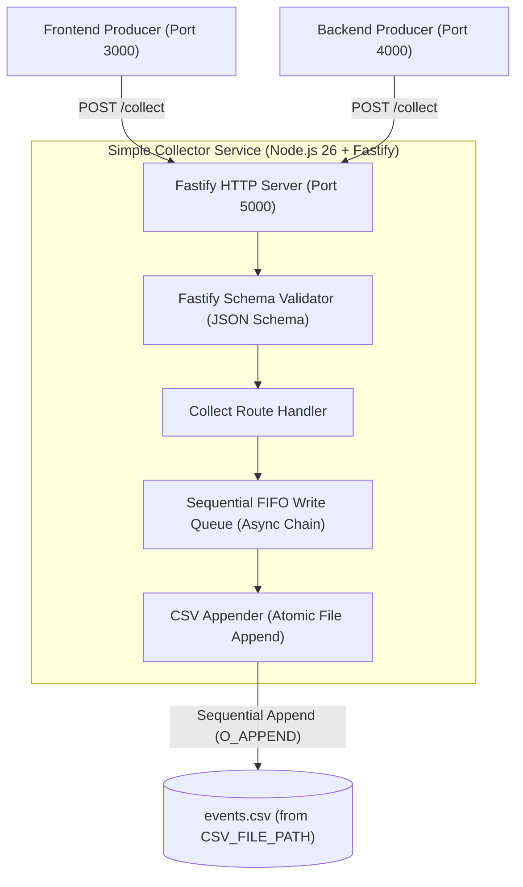
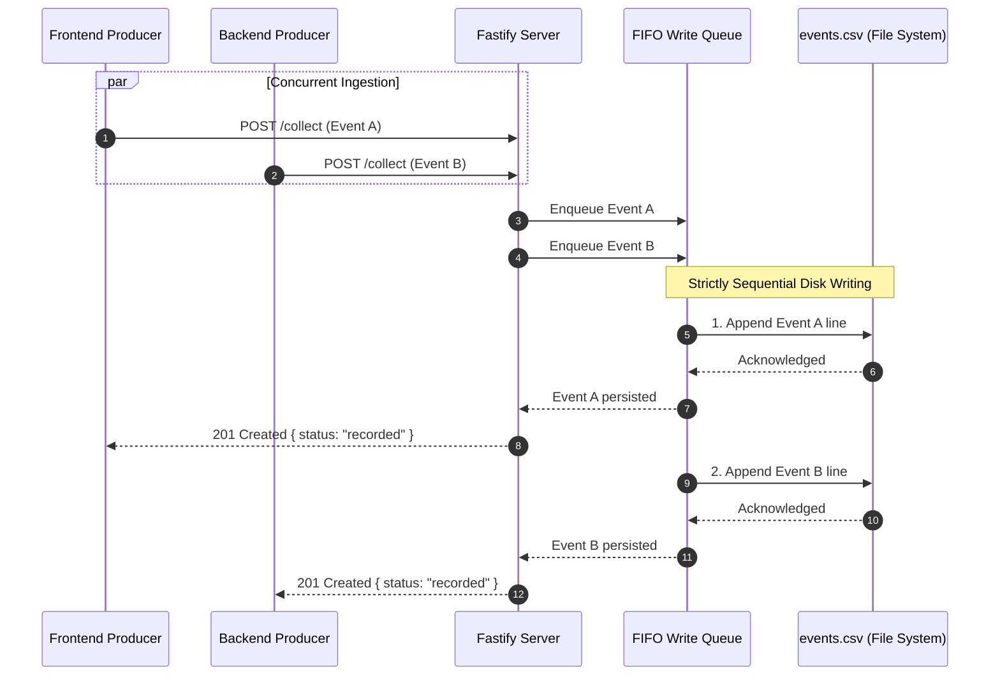

# Module 4: Simple Collector Service

## 1. Overview
The **Simple Collector Service** is an ultra-lightweight, high-performance audit HTTP service built with **Node.js 26** and **Fastify**. Its sole responsibility is to act as the authoritative ground-truth recorder for all behavioral events emitted during end-to-end testing.

When the **Frontend Producer** or **Backend Producer** dispatches an event to OpenSnowcat, it simultaneously sends an audit ping to the Simple Collector containing:
- `event_id`: Unique identifier (UUIDv4) of the event.
- `timestamp`: Event creation timestamp (ISO-8601 UTC).
- `source`: Producer origin (`"frontend"` or `"backend"`).
- `event_type`: Specific event type (e.g., `"page_view"`, `"struct_event"`, `"self_describing"`, `"backend_api"`).

The Simple Collector writes these events **strictly sequentially** to an **append-only** CSV file specified by an environment variable (`CSV_FILE_PATH`). The resulting CSV file serves as the definitive reference list of all events that were transmitted into the OpenSnowcat infrastructure.

---

## 2. Architecture & Sequential Append Flow

### 2.1 Component Architecture



### 2.2 Concurrent Ingestion vs. Sequential Persistence

Under test loads, the Test Bot may generate dozens or hundreds of concurrent requests across Frontend and Backend. To prevent race conditions, corrupted lines, or interleaved writes:

1. **Concurrent HTTP Reception:** Fastify receives and validates incoming requests asynchronously at maximum throughput.
2. **FIFO Promise Chaining / Task Queue:** Validated payloads are passed to `CsvWriterService`. All write tasks enter a sequential FIFO queue.
3. **Sequential Execution:** Writes execute strictly one after another (`queue = queue.then(...)`).
4. **Append-Only Mode:** Writes use standard append mode (`flag: 'a'`). Existing entries are preserved; new rows are appended to the end of the file.
5. **Auto-Header Initialization:** If the file does not exist upon service startup or during the first write, the header row is written first.



---

## 3. Technical Stack & Dependencies

- **Runtime:** **Node.js 26** (native ESM, native fetch, high performance).
- **HTTP Framework:** **Fastify v5+** (lightweight, minimal overhead, fast JSON parsing).
- **CORS Plugin:** `@fastify/cors` (allows direct browser requests from Frontend Producer on port 3000).
- **Schema Validation:** Fastify built-in JSON Schema (compiled with Ajv for maximum serialization speed and validation).
- **File System:** Native Node.js `node:fs/promises` and `node:path`.

### `package.json`

```json
{
  "name": "simple-collector",
  "version": "1.0.0",
  "type": "module",
  "scripts": {
    "start": "node --no-warnings dist/index.js",
    "dev": "node --watch src/index.ts",
    "build": "tsc",
    "test": "vitest run",
    "test:watch": "vitest"
  },
  "dependencies": {
    "fastify": "^5.2.0",
    "@fastify/cors": "^10.0.1",
    "dotenv": "^16.4.7"
  },
  "devDependencies": {
    "@types/node": "^22.10.0",
    "typescript": "^5.7.0",
    "vitest": "^3.0.0"
  }
}
```

---

## 4. Configuration & Environment Variables

All settings are configured via environment variables. The CSV destination file location is strictly controlled through an environment variable.

| Variable | Type | Default | Description |
|---|---|---|---|
| `CSV_FILE_PATH` | String | `./data/events.csv` | **Required/Configurable.** Target file path where events are appended. |
| `PORT` | Number | `5000` | Port on which Fastify listens. |
| `HOST` | String | `0.0.0.0` | Host interface binding. |
| `CORS_ORIGIN` | String | `*` | Allowed CORS origins for browser cross-origin requests. |
| `LOG_LEVEL` | String | `info` | Fastify logger level (`fatal`, `error`, `warn`, `info`, `debug`, `trace`). |

### Environment Configuration Module (`src/config/env.ts`)

```typescript
import path from 'node:path';

export interface AppConfig {
  port: number;
  host: string;
  corsOrigin: string;
  csvFilePath: string;
  logLevel: string;
}

export function loadConfig(): AppConfig {
  const envCsvPath = process.env.CSV_FILE_PATH || process.env.EVENTS_CSV_PATH || './data/events.csv';

  return {
    port: parseInt(process.env.PORT || '5000', 10),
    host: process.env.HOST || '0.0.0.0',
    corsOrigin: process.env.CORS_ORIGIN || '*',
    csvFilePath: path.resolve(process.cwd(), envCsvPath),
    logLevel: process.env.LOG_LEVEL || 'info',
  };
}
```

---

## 5. CSV Persistence Specifications

### 5.1 Format & Column Headers
The CSV file uses UTF-8 encoding, standard comma delimiter (`,`), double-quote escaping, and newline (`\n`) row delimiters:

```csv
event_id,timestamp,source,event_type
```

### 5.2 Header Initialization & Append-Only Rule
- **Initialization:** When the service boots or writes its first row, it checks if the target CSV file already exists.
  - If the file **does not exist**, the parent directory is created recursively (`fs.mkdir(dir, { recursive: true })`), and the header line is written: `event_id,timestamp,source,event_type\n`.
  - If the file **already exists**, it is left untouched; no header is prepended and existing lines are preserved.
- **Append-Only Mode:** Every recorded event is appended directly to the end of the file using append flags (`flag: 'a'`).

### 5.3 Row Escaping & Sanitization
To ensure uncorrupted CSV data even if arbitrary strings are passed:
- Strings containing commas (`,`), double quotes (`"`), or newlines (`\n`, `\r`) are enclosed in double quotes.
- Internal double quotes are escaped by doubling them (`""`).
- Newlines in values are replaced or stripped.

### 5.4 Example Output (`events.csv`)
```csv
event_id,timestamp,source,event_type
c1a2b3c4-d5e6-7890-abcd-ef1234567890,2026-10-11T14:30:00.123Z,backend,backend_api
d2e3f4a5-b6c7-8901-cdef-1234567890ab,2026-10-11T14:30:00.245Z,frontend,page_view
e3f4a5b6-c7d8-9012-def0-2345678901bc,2026-10-11T14:30:00.312Z,frontend,struct_event
f4a5b6c7-d8e9-0123-ef01-3456789012cd,2026-10-11T14:30:00.315Z,frontend,self_describing
```

---

## 6. API Endpoints Specification

### 6.1 `POST /collect`
Endpoint called by Frontend and Backend producers for every emitted event.

- **URL:** `/collect`
- **Method:** `POST`
- **Request Headers:**
  - `Content-Type: application/json`
- **Fastify JSON Schema:**
  ```json
  {
    "body": {
      "type": "object",
      "required": ["event_id", "timestamp", "source", "event_type"],
      "properties": {
        "event_id": { "type": "string", "minLength": 1 },
        "timestamp": { "type": "string", "minLength": 1 },
        "source": { "type": "string", "enum": ["frontend", "backend"] },
        "event_type": { "type": "string", "minLength": 1 }
      },
      "additionalProperties": false
    }
  }
  ```
- **Example Request Body:**
  ```json
  {
    "event_id": "c1a2b3c4-d5e6-7890-abcd-ef1234567890",
    "timestamp": "2026-10-11T14:30:00.123Z",
    "source": "frontend",
    "event_type": "struct_event"
  }
  ```
- **Responses:**
  - `201 Created`
    ```json
    {
      "status": "recorded",
      "event_id": "c1a2b3c4-d5e6-7890-abcd-ef1234567890"
    }
    ```
  - `400 Bad Request` (Fastify automatic schema validation failure)
    ```json
    {
      "statusCode": 400,
      "error": "Bad Request",
      "message": "body/source must be equal to one of the allowed values"
    }
    ```

### 6.2 `GET /health`
Liveness probe for orchestration and test runners.

- **URL:** `/health`
- **Method:** `GET`
- **Response:** `200 OK`
  ```json
  {
    "status": "ok",
    "service": "simple-collector"
  }
  ```

### 6.3 `GET /stats`
Inspects real-time recording counters and current file destination.

- **URL:** `/stats`
- **Method:** `GET`
- **Response:** `200 OK`
  ```json
  {
    "total_recorded": 1500,
    "frontend_events": 500,
    "backend_events": 1000,
    "csv_file_path": "/path/to/events.csv"
  }
  ```

### 6.4 `POST /reset`
Truncates the CSV file and resets in-memory stats. Useful before beginning a fresh test session.

- **URL:** `/reset`
- **Method:** `POST`
- **Response:** `200 OK`
  ```json
  {
    "status": "reset",
    "csv_file_path": "/path/to/events.csv"
  }
  ```

---

## 7. Implementation Blueprint

### 7.1 Directory Layout

```
apps/simple-collector/
├── package.json
├── tsconfig.json
├── Dockerfile
├── .env.example
├── src/
│   ├── index.ts                     # Fastify server startup & entrypoint
│   ├── app.ts                       # Fastify application factory (plugins & routes)
│   ├── config/
│   │   └── env.ts                   # Environment variable loader
│   ├── schemas/
│   │   └── collect.schema.ts        # Fastify JSON schemas for routes
│   ├── services/
│   │   └── csv-writer.service.ts    # Sequential append-only CSV writer
│   └── routes/
│       ├── collect.route.ts         # POST /collect handler
│       ├── health.route.ts          # GET /health & GET /stats handlers
│       └── reset.route.ts           # POST /reset handler
└── tests/
    ├── unit/
    │   ├── env.test.ts              # Config unit tests
    │   └── csv-writer.service.test.ts # Sequential append queue unit tests
    └── integration/
        └── collector.api.test.ts    # Fastify inject API integration tests
```

---

### 7.2 Sequential CSV Writer Service (`src/services/csv-writer.service.ts`)

This service guarantees:
1. Directory existence.
2. File existence check and one-time header initialization.
3. Strict FIFO queue serialization of all incoming write operations.
4. Thread-safe, non-overlapping append operations.

```typescript
import fs from 'node:fs/promises';
import path from 'node:path';

export interface EventRecord {
  event_id: string;
  timestamp: string;
  source: 'frontend' | 'backend';
  event_type: string;
}

export interface CollectorStats {
  total_recorded: number;
  frontend_events: number;
  backend_events: number;
  csv_file_path: string;
}

export class CsvWriterService {
  private readonly filePath: string;
  private writeQueue: Promise<void> = Promise.resolve();
  private isInitialized = false;

  private totalRecorded = 0;
  private frontendEvents = 0;
  private backendEvents = 0;

  constructor(filePath: string) {
    this.filePath = filePath;
  }

  /**
   * Initializes the directory and CSV file with header if not present.
   */
  public async initialize(): Promise<void> {
    if (this.isInitialized) return;

    const dir = path.dirname(this.filePath);
    await fs.mkdir(dir, { recursive: true });

    try {
      await fs.access(this.filePath);
    } catch {
      // File does not exist: write header row
      const header = 'event_id,timestamp,source,event_type\n';
      await fs.writeFile(this.filePath, header, { encoding: 'utf-8', flag: 'wx' });
    }

    this.isInitialized = true;
  }

  /**
   * Appends an event record strictly sequentially.
   */
  public async append(record: EventRecord): Promise<void> {
    // Chain onto the write queue to guarantee sequential execution
    return new Promise((resolve, reject) => {
      this.writeQueue = this.writeQueue
        .then(async () => {
          if (!this.isInitialized) {
            await this.initialize();
          }

          const line = this.formatRow(record);
          await fs.appendFile(this.filePath, line, { encoding: 'utf-8', flag: 'a' });

          // Update internal stats
          this.totalRecorded++;
          if (record.source === 'frontend') {
            this.frontendEvents++;
          } else {
            this.backendEvents++;
          }

          resolve();
        })
        .catch((err) => {
          // Reject caller but keep the queue healthy for future writes
          reject(err);
        });
    });
  }

  /**
   * Formats and escapes a row for safe CSV storage.
   */
  private formatRow(record: EventRecord): string {
    const sanitize = (val: string): string => {
      if (val == null) return '';
      const str = String(val).replace(/[\r\n]+/g, ' ');
      if (str.includes(',') || str.includes('"')) {
        return `"${str.replace(/"/g, '""')}"`;
      }
      return str;
    };

    return [
      sanitize(record.event_id),
      sanitize(record.timestamp),
      sanitize(record.source),
      sanitize(record.event_type)
    ].join(',') + '\n';
  }

  /**
   * Resets the CSV file back to just the header row.
   */
  public async reset(): Promise<void> {
    return new Promise((resolve, reject) => {
      this.writeQueue = this.writeQueue
        .then(async () => {
          const dir = path.dirname(this.filePath);
          await fs.mkdir(dir, { recursive: true });

          const header = 'event_id,timestamp,source,event_type\n';
          await fs.writeFile(this.filePath, header, { encoding: 'utf-8' });

          this.totalRecorded = 0;
          this.frontendEvents = 0;
          this.backendEvents = 0;
          this.isInitialized = true;

          resolve();
        })
        .catch(reject);
    });
  }

  public getStats(): CollectorStats {
    return {
      total_recorded: this.totalRecorded,
      frontend_events: this.frontendEvents,
      backend_events: this.backendEvents,
      csv_file_path: this.filePath
    };
  }
}
```

---

### 7.3 Fastify Route Schemas (`src/schemas/collect.schema.ts`)

```typescript
import { FastifySchema } from 'fastify';

export const collectSchema: FastifySchema = {
  description: 'Appends a test event record to the sequential CSV file',
  tags: ['Collection'],
  body: {
    type: 'object',
    required: ['event_id', 'timestamp', 'source', 'event_type'],
    properties: {
      event_id: { type: 'string', minLength: 1 },
      timestamp: { type: 'string', minLength: 1 },
      source: { type: 'string', enum: ['frontend', 'backend'] },
      event_type: { type: 'string', minLength: 1 },
    },
    additionalProperties: false,
  },
  response: {
    201: {
      type: 'object',
      properties: {
        status: { type: 'string' },
        event_id: { type: 'string' },
      },
      required: ['status', 'event_id'],
    },
  },
};
```

---

### 7.4 Collect Route Handler (`src/routes/collect.route.ts`)

```typescript
import { FastifyPluginAsync } from 'fastify';
import { collectSchema } from '../schemas/collect.schema.js';
import { CsvWriterService, EventRecord } from '../services/csv-writer.service.js';

export const collectRoutes: FastifyPluginAsync<{ csvWriter: CsvWriterService }> = async (
  fastify,
  opts
) => {
  const { csvWriter } = opts;

  fastify.post<{ Body: EventRecord }>(
    '/collect',
    { schema: collectSchema },
    async (request, reply) => {
      const record = request.body;

      await csvWriter.append(record);

      return reply.code(201).send({
        status: 'recorded',
        event_id: record.event_id,
      });
    }
  );
};
```

---

### 7.5 Application Factory (`src/app.ts`)

```typescript
import Fastify, { FastifyInstance } from 'fastify';
import cors from '@fastify/cors';
import { AppConfig } from './config/env.js';
import { CsvWriterService } from './services/csv-writer.service.js';
import { collectRoutes } from './routes/collect.route.js';
import { healthRoutes } from './routes/health.route.js';
import { resetRoutes } from './routes/reset.route.js';

export async function buildApp(
  config: AppConfig,
  csvWriterService?: CsvWriterService
): Promise<FastifyInstance> {
  const app = Fastify({
    logger: { level: config.logLevel }
  });

  // Enable CORS for browser Frontend requests
  await app.register(cors, {
    origin: config.corsOrigin,
    methods: ['GET', 'POST', 'OPTIONS'],
  });

  const csvWriter = csvWriterService ?? new CsvWriterService(config.csvFilePath);
  await csvWriter.initialize();

  // Register routes
  await app.register(collectRoutes, { csvWriter });
  await app.register(healthRoutes, { csvWriter });
  await app.register(resetRoutes, { csvWriter });

  return app;
}
```

---

### 7.6 Entrypoint (`src/index.ts`)

```typescript
import { loadConfig } from './config/env.js';
import { buildApp } from './app.js';

async function start() {
  const config = loadConfig();
  const app = await buildApp(config);

  try {
    const address = await app.listen({ port: config.port, host: config.host });
    app.log.info(`Simple Collector listening on ${address}`);
    app.log.info(`Appending events to: ${config.csvFilePath}`);
  } catch (err) {
    app.log.error(err);
    process.exit(1);
  }
}

start();
```

---

### 7.7 Dockerfile Specification (`apps/simple-collector/Dockerfile`)

```dockerfile
FROM node:26-alpine AS builder
WORKDIR /app
COPY package*.json tsconfig.json ./
RUN npm ci
COPY src ./src
RUN npm run build

FROM node:26-alpine AS runner
WORKDIR /app
ENV NODE_ENV=production
ENV PORT=5000
ENV CSV_FILE_PATH=/app/data/events.csv

COPY package*.json ./
RUN npm ci --omit=dev

COPY --from=builder /app/dist ./dist
RUN mkdir -p /app/data && chown -R node:node /app

USER node
EXPOSE 5000

HEALTHCHECK --interval=5s --timeout=3s --retries=5 --start-period=3s \
  CMD wget -qO- http://localhost:5000/health || exit 1

CMD ["node", "dist/index.js"]
```

---

## 8. Testing Strategy

The Simple Collector follows the repository's strict testing standards:
1. **1:1 Unit Tests:** Dedicated test file for each unit (`env.test.ts`, `csv-writer.service.test.ts`).
2. **Integration Tests:** End-to-end API testing via Fastify's native `app.inject()` simulating real HTTP requests, testing concurrency, and verifying CSV file state on disk without mocking.

### 8.1 Unit Test: Sequential CSV Writer (`tests/unit/csv-writer.service.test.ts`)

```typescript
import { describe, it, expect, beforeEach, afterEach } from 'vitest';
import fs from 'node:fs/promises';
import path from 'node:path';
import os from 'node:os';
import { CsvWriterService } from '../../src/services/csv-writer.service.js';

describe('CsvWriterService', () => {
  let tempDir: string;
  let testCsvPath: string;

  beforeEach(async () => {
    tempDir = await fs.mkdtemp(path.join(os.tmpdir(), 'simple-collector-test-'));
    testCsvPath = path.join(tempDir, 'events.csv');
  });

  afterEach(async () => {
    await fs.rm(tempDir, { recursive: true, force: true });
  });

  it('initializes the file with a header if it does not exist', async () => {
    const writer = new CsvWriterService(testCsvPath);
    await writer.initialize();

    const content = await fs.readFile(testCsvPath, 'utf-8');
    expect(content).toBe('event_id,timestamp,source,event_type\n');
  });

  it('appends records sequentially and preserves existing rows', async () => {
    const writer = new CsvWriterService(testCsvPath);
    await writer.initialize();

    await writer.append({
      event_id: 'uuid-1',
      timestamp: '2026-10-11T12:00:00.000Z',
      source: 'frontend',
      event_type: 'page_view',
    });

    await writer.append({
      event_id: 'uuid-2',
      timestamp: '2026-10-11T12:00:01.000Z',
      source: 'backend',
      event_type: 'backend_api',
    });

    const content = await fs.readFile(testCsvPath, 'utf-8');
    const lines = content.trim().split('\n');

    expect(lines).toHaveLength(3);
    expect(lines[0]).toBe('event_id,timestamp,source,event_type');
    expect(lines[1]).toBe('uuid-1,2026-10-11T12:00:00.000Z,frontend,page_view');
    expect(lines[2]).toBe('uuid-2,2026-10-11T12:00:01.000Z,backend,backend_api');
  });

  it('guarantees sequential write integrity under high concurrency', async () => {
    const writer = new CsvWriterService(testCsvPath);
    await writer.initialize();

    const count = 200;
    const promises = Array.from({ length: count }, (_, i) =>
      writer.append({
        event_id: `uuid-${i}`,
        timestamp: new Date().toISOString(),
        source: i % 2 === 0 ? 'frontend' : 'backend',
        event_type: 'test_event',
      })
    );

    await Promise.all(promises);

    const content = await fs.readFile(testCsvPath, 'utf-8');
    const lines = content.trim().split('\n');

    // 1 header + 200 lines
    expect(lines).toHaveLength(count + 1);
    expect(writer.getStats().total_recorded).toBe(count);
  });
});
```

---

### 8.2 Integration Test: Full API Flow (`tests/integration/collector.api.test.ts`)

Simulates real HTTP traffic through Fastify without mocking external services, verifying API responses, schema validation, and disk state.

```typescript
import { describe, it, expect, beforeEach, afterEach } from 'vitest';
import fs from 'node:fs/promises';
import path from 'node:path';
import os from 'node:os';
import { FastifyInstance } from 'fastify';
import { buildApp } from '../../src/app.js';
import { AppConfig } from '../../src/config/env.js';

describe('Simple Collector API Integration', () => {
  let app: FastifyInstance;
  let tempDir: string;
  let csvPath: string;

  beforeEach(async () => {
    tempDir = await fs.mkdtemp(path.join(os.tmpdir(), 'collector-api-test-'));
    csvPath = path.join(tempDir, 'test-events.csv');

    const testConfig: AppConfig = {
      port: 0,
      host: '127.0.0.1',
      corsOrigin: '*',
      csvFilePath: csvPath,
      logLevel: 'silent',
    };

    app = await buildApp(testConfig);
  });

  afterEach(async () => {
    await app.close();
    await fs.rm(tempDir, { recursive: true, force: true });
  });

  it('responds with 200 on GET /health', async () => {
    const response = await app.inject({
      method: 'GET',
      url: '/health',
    });

    expect(response.statusCode).toBe(200);
    expect(response.json()).toEqual({ status: 'ok', service: 'simple-collector' });
  });

  it('accepts valid POST /collect and writes to CSV', async () => {
    const payload = {
      event_id: 'a1b2c3d4-e5f6-7890-abcd-ef0123456789',
      timestamp: '2026-10-11T15:00:00.000Z',
      source: 'backend',
      event_type: 'backend_api',
    };

    const response = await app.inject({
      method: 'POST',
      url: '/collect',
      payload,
    });

    expect(response.statusCode).toBe(201);
    expect(response.json()).toEqual({
      status: 'recorded',
      event_id: payload.event_id,
    });

    // Verify CSV file on disk
    const content = await fs.readFile(csvPath, 'utf-8');
    const lines = content.trim().split('\n');
    expect(lines).toHaveLength(2);
    expect(lines[1]).toBe(`${payload.event_id},${payload.timestamp},backend,backend_api`);
  });

  it('rejects invalid payload with 400 Bad Request', async () => {
    const invalidPayload = {
      event_id: 'not-enough-fields',
      source: 'invalid_source', // not "frontend" | "backend"
    };

    const response = await app.inject({
      method: 'POST',
      url: '/collect',
      payload: invalidPayload,
    });

    expect(response.statusCode).toBe(400);
  });

  it('handles concurrent requests cleanly and accurately updates GET /stats', async () => {
    const count = 50;
    const requests = Array.from({ length: count }, (_, i) =>
      app.inject({
        method: 'POST',
        url: '/collect',
        payload: {
          event_id: `evt-${i}`,
          timestamp: '2026-10-11T15:00:00.000Z',
          source: i % 2 === 0 ? 'frontend' : 'backend',
          event_type: 'batch_test',
        },
      })
    );

    const responses = await Promise.all(requests);
    responses.forEach((res) => expect(res.statusCode).toBe(201));

    const statsRes = await app.inject({ method: 'GET', url: '/stats' });
    expect(statsRes.statusCode).toBe(200);
    const stats = statsRes.json();
    expect(stats.total_recorded).toBe(50);
    expect(stats.frontend_events).toBe(25);
    expect(stats.backend_events).toBe(25);
  });
});
```

---

## 9. Summary of Key Guarantees

| Requirement | Implementation Mechanism |
|---|---|
| **Runtime & Framework** | Node.js 26 + Fastify v5+ for maximum throughput and minimal resource usage. |
| **API Purpose** | Exposes `POST /collect` receiving `{ event_id, timestamp, source, event_type }` and writes rows. |
| **Sequential Appending** | In-memory FIFO Promise queue ensuring serialized, non-overlapping writes to disk. |
| **Append-Only Mode** | Uses `fs.appendFile` (`flag: 'a'`), preserving all existing data and never overwriting. |
| **Configurable File Path** | Environment variable `CSV_FILE_PATH` (defaults to `./data/events.csv`), directory created recursively. |
| **Testing Standard** | 1:1 unit test files + Fastify `app.inject()` integration tests validating disk state and concurrency. |
