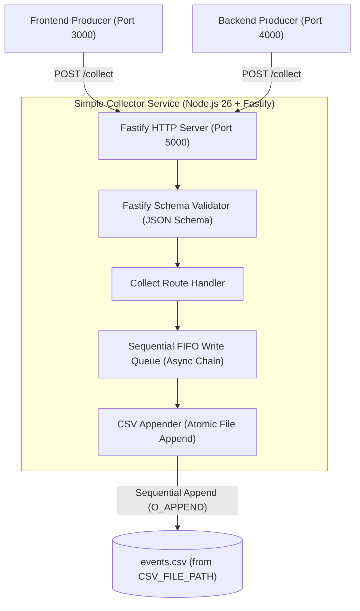
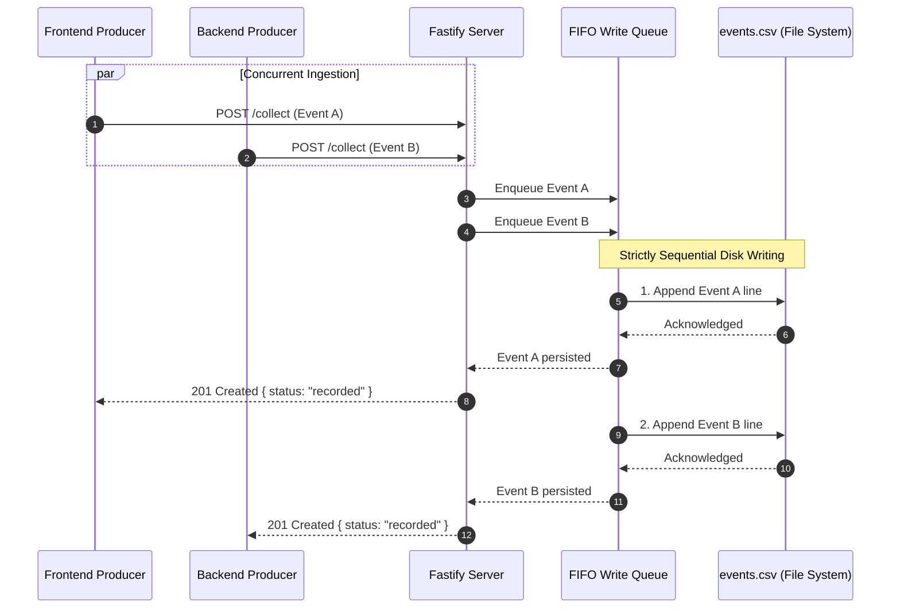

# Module 4: Simple Collector Service

## 1. Overview
The **Simple Collector Service** is an ultra-lightweight, high-performance audit HTTP service built with **Node.js 26** and **Fastify**. Its sole responsibility is to act as the authoritative ground-truth recorder for all behavioral events emitted during end-to-end testing.

When the **Frontend Producer** or **Backend Producer** dispatches an event to OpenSnowcat, it simultaneously sends an audit ping to the Simple Collector containing:
- `event_id`: Unique identifier (UUIDv4) of the event.
- `timestamp`: Event creation timestamp (ISO-8601 UTC).
- `source`: Producer origin (`"frontend"` or `"backend"`).
- `event_type`: Specific event type (e.g., `"page_view"`, `"struct_event"`, `"self_describing"`, `"backend_api"`).

The Simple Collector writes these events **strictly sequentially** to an **append-only** CSV file specified by an environment variable (`CSV_FILE_PATH`). The resulting CSV file serves as the definitive reference list of all events that were transmitted into the OpenSnowcat infrastructure.

---

## 2. Architecture & Sequential Append Flow

### 2.1 Component Architecture



### 2.2 Concurrent Ingestion vs. Sequential Persistence

Under test loads, the Test Bot may generate dozens or hundreds of concurrent requests across Frontend and Backend. To prevent race conditions, corrupted lines, or interleaved writes:

1. **Concurrent HTTP Reception:** Fastify receives and validates incoming requests asynchronously at maximum throughput.
2. **FIFO Promise Chaining / Task Queue:** Validated payloads are passed to `CsvWriterService`. All write tasks enter a sequential FIFO queue.
3. **Sequential Execution:** Writes execute strictly one after another (`queue = queue.then(...)`).
4. **Append-Only Mode:** Writes use standard append mode (`flag: 'a'`). Existing entries are preserved; new rows are appended to the end of the file.
5. **Auto-Header Initialization:** If the file does not exist upon service startup or during the first write, the header row is written first.



---

## 3. Technical Stack & Dependencies

- **Runtime:** **Node.js 26** (native ESM, native fetch, high performance).
- **HTTP Framework:** **Fastify v5+** (lightweight, minimal overhead, fast JSON parsing).
- **CORS Plugin:** `@fastify/cors` (allows direct browser requests from Frontend Producer on port 3000).
- **Schema Validation:** Fastify built-in JSON Schema (compiled with Ajv for maximum serialization speed and validation).
- **File System:** Native Node.js `node:fs/promises` and `node:path`.

### `package.json`

See [`package.json`](../../apps/simple-collector/package.json) for scripts and dependency versions.

**Notes:**
- `dotenv` is loaded at initialization in `src/config/env.ts` to support `.env` files.
- `package-lock.json` **must be committed**: the Dockerfile runs `npm ci`, which fails without it.

### `tsconfig.json`

See [`tsconfig.json`](../../apps/simple-collector/tsconfig.json): ES2022 target, NodeNext modules, `src` → `dist`, strict mode.

---

## 4. Configuration & Environment Variables

All settings are configured via environment variables. The CSV destination file location is strictly controlled through an environment variable.

| Variable | Type | Default | Description |
|---|---|---|---|
| `CSV_FILE_PATH` | String | `./data/events.csv` | **Required/Configurable.** Target file path where events are appended. |
| `PORT` | Number | `5000` | Port on which Fastify listens. |
| `HOST` | String | `0.0.0.0` | Host interface binding. |
| `CORS_ORIGIN` | String | `*` | Allowed CORS origins for browser cross-origin requests. |
| `LOG_LEVEL` | String | `info` | Fastify logger level (`fatal`, `error`, `warn`, `info`, `debug`, `trace`). |

### Environment Configuration Module

Implemented in [`src/config/env.ts`](../../apps/simple-collector/src/config/env.ts): `loadConfig()` returns `AppConfig` (`port`, `host`, `corsOrigin`, `csvFilePath`, `logLevel`). `csvFilePath` is resolved against `process.cwd()` from `CSV_FILE_PATH`, falling back to `EVENTS_CSV_PATH`, then `./data/events.csv`.

---

## 5. CSV Persistence Specifications

### 5.1 Format & Column Headers
The CSV file uses UTF-8 encoding, standard comma delimiter (`,`), double-quote escaping, and newline (`\n`) row delimiters:

```csv
event_id,timestamp,source,event_type
```

### 5.2 Header Initialization & Append-Only Rule
- **Initialization:** When the service boots or writes its first row, it checks if the target CSV file already exists.
  - If the file **does not exist**, the parent directory is created recursively (`fs.mkdir(dir, { recursive: true })`), and the header line is written: `event_id,timestamp,source,event_type\n`.
  - If the file **already exists**, it is left untouched; no header is prepended and existing lines are preserved.
- **Append-Only Mode:** Every recorded event is appended directly to the end of the file using append flags (`flag: 'a'`).

### 5.3 Row Escaping & Sanitization
To ensure uncorrupted CSV data even if arbitrary strings are passed:
- Strings containing commas (`,`), double quotes (`"`), or newlines (`\n`, `\r`) are enclosed in double quotes.
- Internal double quotes are escaped by doubling them (`""`).
- Newlines in values are replaced or stripped.

### 5.4 Example Output (`events.csv`)
```csv
event_id,timestamp,source,event_type
c1a2b3c4-d5e6-7890-abcd-ef1234567890,2026-10-11T14:30:00.123Z,backend,backend_api
d2e3f4a5-b6c7-8901-cdef-1234567890ab,2026-10-11T14:30:00.245Z,frontend,page_view
e3f4a5b6-c7d8-9012-def0-2345678901bc,2026-10-11T14:30:00.312Z,frontend,struct_event
f4a5b6c7-d8e9-0123-ef01-3456789012cd,2026-10-11T14:30:00.315Z,frontend,self_describing
```

---

## 6. API Endpoints Specification

### 6.1 `POST /collect`
Endpoint called by Frontend and Backend producers for every emitted event.

- **URL:** `/collect`
- **Method:** `POST`
- **Request Headers:**
  - `Content-Type: application/json`
- **Fastify JSON Schema:**
  ```json
  {
    "body": {
      "type": "object",
      "required": ["event_id", "timestamp", "source", "event_type"],
      "properties": {
        "event_id": { "type": "string", "minLength": 1 },
        "timestamp": { "type": "string", "minLength": 1 },
        "source": { "type": "string", "enum": ["frontend", "backend"] },
        "event_type": { "type": "string", "minLength": 1 }
      },
      "additionalProperties": false
    }
  }
  ```
- **Example Request Body:**
  ```json
  {
    "event_id": "c1a2b3c4-d5e6-7890-abcd-ef1234567890",
    "timestamp": "2026-10-11T14:30:00.123Z",
    "source": "frontend",
    "event_type": "struct_event"
  }
  ```
- **Responses:**
  - `201 Created`
    ```json
    {
      "status": "recorded",
      "event_id": "c1a2b3c4-d5e6-7890-abcd-ef1234567890"
    }
    ```
  - `400 Bad Request` (missing/empty required fields or invalid `source`; Fastify automatic schema validation failure)
    ```json
    {
      "statusCode": 400,
      "error": "Bad Request",
      "message": "body/source must be equal to one of the allowed values"
    }
    ```

### 6.2 `GET /health`
Liveness probe for orchestration and test runners.

- **URL:** `/health`
- **Method:** `GET`
- **Response:** `200 OK`
  ```json
  {
    "status": "ok",
    "service": "simple-collector"
  }
  ```

### 6.3 `GET /stats`
Inspects real-time recording counters and current file destination.

- **URL:** `/stats`
- **Method:** `GET`
- **Response:** `200 OK`
  ```json
  {
    "total_recorded": 1500,
    "frontend_events": 500,
    "backend_events": 1000,
    "csv_file_path": "/path/to/events.csv"
  }
  ```

### 6.4 `POST /reset`
Truncates the CSV file and resets in-memory stats. Useful before beginning a fresh test session.

- **URL:** `/reset`
- **Method:** `POST`
- **Response:** `200 OK`
  ```json
  {
    "status": "reset",
    "csv_file_path": "/path/to/events.csv"
  }
  ```

---

## 7. Implementation & Directory Layout

Direct reference to the files implementing the service in [`apps/simple-collector/`](../../apps/simple-collector/):

```
apps/simple-collector/
├── package.json                 # Scripts & dependencies
├── tsconfig.json                # TypeScript NodeNext configuration
├── package-lock.json            # Lockfile (required for Docker build npm ci)
├── Dockerfile                   # Multi-stage production container build
├── .env.example                 # Sample environment variables
├── .gitignore                   # Ignore node_modules, dist, data
├── src/
│   ├── index.ts                 # Server startup & CLI entrypoint
│   ├── app.ts                   # Fastify app factory (CORS & routes setup)
│   ├── config/
│   │   └── env.ts               # Environment configuration loader
│   ├── schemas/
│   │   └── collect.schema.ts    # JSON Schema validation (augmented for Fastify)
│   ├── services/
│   │   └── csv-writer.service.ts # FIFO sequential append & CSV sanitization
│   └── routes/
│       ├── collect.route.ts     # POST /collect handler
│       ├── health.route.ts      # GET /health & GET /stats handlers
│       └── reset.route.ts       # POST /reset handler
└── tests/
    ├── unit/                    # 1:1 unit test suite (8 test files)
    │   ├── env.test.ts
    │   ├── csv-writer.service.test.ts
    │   ├── collect.schema.test.ts
    │   ├── collect.route.test.ts
    │   ├── health.route.test.ts
    │   ├── reset.route.test.ts
    │   ├── app.test.ts
    │   └── index.test.ts
    └── integration/             # Fastify inject integration tests
        └── collector.api.test.ts
```

### 7.7 Dockerfile Specification (`apps/simple-collector/Dockerfile`)

```dockerfile
FROM node:26-alpine AS builder
WORKDIR /app
COPY package*.json tsconfig.json ./
RUN npm ci
COPY src ./src
RUN npm run build

FROM node:26-alpine AS runner
WORKDIR /app
ENV NODE_ENV=production
ENV PORT=5000
ENV CSV_FILE_PATH=/app/data/events.csv

COPY package*.json ./
RUN npm ci --omit=dev

COPY --from=builder /app/dist ./dist
RUN mkdir -p /app/data && chown -R node:node /app

USER node
EXPOSE 5000

HEALTHCHECK --interval=5s --timeout=3s --retries=5 --start-period=3s \
  CMD wget -qO- http://localhost:5000/health || exit 1

CMD ["node", "dist/index.js"]
```

---

## 8. Testing Strategy

1. **Unit Tests (1:1):** Every source file in `src/` has a matching unit test under [`tests/unit/`](../../apps/simple-collector/tests/unit/).
2. **Integration Tests:** [`tests/integration/collector.api.test.ts`](../../apps/simple-collector/tests/integration/collector.api.test.ts) runs full HTTP integration tests via Fastify `app.inject()` verifying sequential concurrency, disk state, and API status codes.

### 8.1 Development, Linting & Test Execution Commands

```bash
# 1. Run type check & static analysis (tsc --noEmit)
npm run type-check

# 2. Run all unit and integration tests
npm test

# 3. Run tests in watch mode
npm run test:watch

# 4. Compile TypeScript project to dist/
npm run build

# 5. Start development server in watch mode (tsx watch)
npm run dev
```

---

## 9. Summary of Key Guarantees

| Requirement | Implementation Mechanism |
|---|---|
| **Runtime & Framework** | Node.js 26 + Fastify v5+ for maximum throughput and minimal resource usage. |
| **API Purpose** | Exposes `POST /collect` receiving `{ event_id, timestamp, source, event_type }` and writes rows. |
| **Sequential Appending** | In-memory FIFO Promise queue ensuring serialized, non-overlapping writes to disk. |
| **Append-Only Mode** | Uses `fs.appendFile` (`flag: 'a'`), preserving all existing data and never overwriting. |
| **Configurable File Path** | Environment variable `CSV_FILE_PATH` (defaults to `./data/events.csv`), directory created recursively. |
| **Testing Standard** | 1:1 unit test files + Fastify `app.inject()` integration tests validating disk state and concurrency. |
