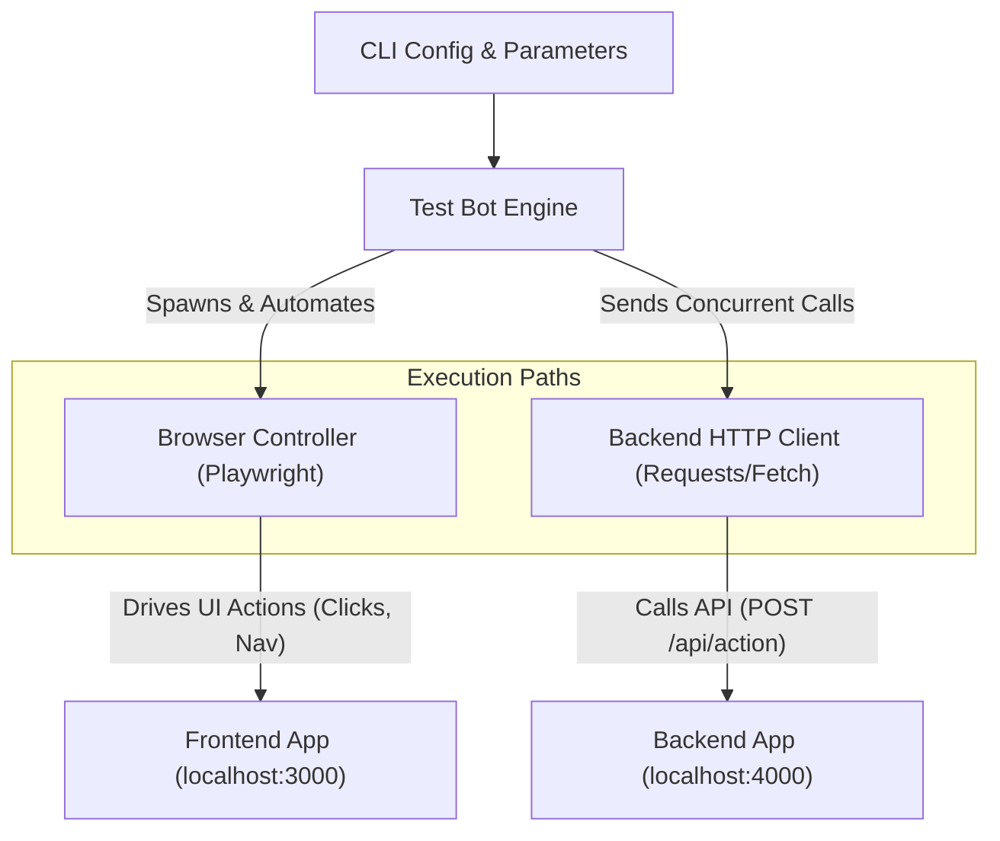

# Module 1: Test Bot (Driver / Orchestrator)

## 1. Overview
The **Test Bot** is the orchestration and driving engine of the test suite. Its responsibility is to generate synthetic traffic by:
1. **Controlling the Frontend Application:** Automating realistic browser interactions (page views, button clicks, form actions) using a headless browser.
2. **Invoking the Backend Application:** Issuing direct HTTP requests to the backend API endpoints.

It acts as the single entrypoint to kick off and control a test run with configurable iteration counts, concurrency, and intervals.

---

## 2. Architecture & Responsibilities



### Core Responsibilities:
- **Browser Automation:** Launch headless/headful browser instances, navigate to the Frontend URL, and trigger UI events.
- **API Traffic Generation:** Send concurrent or paced HTTP requests to the Backend Producer endpoints.
- **Execution Lifecycle:** Provide clean startup, progress bar / live metrics in terminal, and graceful teardown.

---

## 3. Technical Stack & Dependencies

- **Runtime:** **Node.js 26** (using native ESM and native `fetch`)
- **Browser Automation:** **[Playwright](https://playwright.dev/)** (`playwright` / `@playwright/test`)
- **HTTP Client:** Built-in Node 26 `fetch` (no external HTTP library needed)
- **CLI Parser:** `commander`

### Dependencies (`package.json` snippet)
```json
{
  "name": "opensnowcat-bot",
  "version": "1.0.0",
  "type": "module",
  "engines": {
    "node": ">=26.0.0"
  },
  "dependencies": {
    "playwright": "^1.49.0",
    "commander": "^12.1.0"
  }
}
```

### 3.1 Directory Layout

```
apps/test-bot/
├── package.json
├── tsconfig.json
├── Dockerfile
├── src/
│   ├── index.ts                     # CLI entrypoint & Commander argument parser
│   ├── runner.ts                    # Orchestration loop (iterations, concurrency, pacing)
│   ├── controllers/
│   │   ├── browser.controller.ts    # Playwright browser driver (interacts with 5 pages)
│   │   └── api.controller.ts        # Direct HTTP requester to Backend endpoints
│   └── utils/
│       ├── logger.ts                # Real-time console reporting & progress bar
│       └── metrics.ts               # Iteration latencies & success counters
└── tests/
    ├── unit/
    │   ├── api.controller.test.ts   # 1:1 Unit tests for backend API requester
    │   ├── browser.controller.test.ts # 1:1 Unit tests for Playwright browser driver
    │   ├── index.test.ts            # 1:1 Unit tests for CLI entrypoint & argument parsing
    │   ├── logger.test.ts           # 1:1 Unit tests for logger and progress reporting
    │   ├── metrics.test.ts          # 1:1 Unit tests for metrics tracking and summarization
    │   └── runner.test.ts           # 1:1 Unit tests for runner and worker pool orchestration
    └── integration/
        └── bot.integration.test.ts  # End-to-end bot test with mock servers
```

### 3.2 Dockerfile Specification (`apps/test-bot/Dockerfile`)

```dockerfile
FROM mcr.microsoft.com/playwright:v1.49.0-noble AS runner
WORKDIR /app

COPY package*.json tsconfig.json ./
RUN npm ci
COPY src ./src

ENV FRONTEND_URL=http://frontend-producer:3000
ENV BACKEND_URL=http://backend-producer:4000
ENV SIMPLE_COLLECTOR_URL=http://simple-collector:5000
ENV OPENSNOWCAT_URL=http://localhost:8080
ENV ITERATIONS=100
ENV CONCURRENCY=2
ENV DELAY_MS=50
ENV MODE=both
ENV HEADLESS=true

CMD ["npx", "tsx", "src/index.ts"]
```

---

## 4. CLI Interface & Parameters

The Bot is executed via the `opensnowcat-bot` CLI entrypoint (`src/index.ts`). For execution examples across Docker Compose and CLI environments, see [Docker Compose Execution Profiles (`docker-compose.md#63-on-demand-bot-run-with-custom-parameters`)](docker-compose.md#63-on-demand-bot-run-with-custom-parameters) and [Master Overview (`../README.md#4-multi-service-orchestration-docker-compose`)](../README.md#4-multi-service-orchestration-docker-compose).

### Options:
| Flag | Type | Default | Description |
|---|---|---|---|
| `--frontend-url` | `string` | `http://localhost:3000` | Target URL of the Frontend Application. |
| `--backend-url` | `string` | `http://localhost:4000` | Target URL of the Backend Application. |
| `--simple-collector-url` | `string` | `http://localhost:5000` | Target URL of Simple Collector (used for Playwright route rewriting in container networks). |
| `--opensnowcat-url` | `string` | `http://localhost:8080` | Target URL of OpenSnowcat (used for Playwright route rewriting in container networks). |
| `--iterations` | `number` | `100` | Total number of test cycles to execute. |
| `--concurrency` | `number` | `1` | Number of parallel worker threads / browser contexts. |
| `--delay-ms` | `number` | `50` | Artificial pause between iterations in milliseconds. |
| `--mode` | `enum` | `both` | Execution target: `frontend`, `backend`, or `both`. |
| `--headless` | `boolean` | `true` (`false` in `dev` mode) | Run browser in headless mode (`false` for visual debugging). |

---

## 5. Detailed Implementation Logic

### 5.1 Frontend Interaction Flow (Playwright)
1. Initialize browser instance (Chromium).
2. Create an isolated `BrowserContext` and a reusable `Page` per worker.
3. **Container Network URL Rewriting (`context.route`):**
   - The Frontend application bundle is built with browser-facing URLs (`http://localhost:4000`, `http://localhost:5000`, etc.) suitable for external client browsers.
   - When Playwright runs inside the `test-bot` container on the shared bridge network (`snowcat-net`), API and collector requests to `localhost:*` executed by the browser page target the `test-bot` container itself and fail unless host networking is used or requests are rewritten.
   - To maintain cross-platform portability without requiring host networking, the bot configures Playwright route interception (`context.route`) on the browser context:
     ```ts
     // Intercept and route frontend localhost calls to internal Docker service hosts
     await context.route(/^http:\/\/localhost:4000/, route => {
       const target = process.env.BACKEND_URL || 'http://backend-producer:4000';
       route.continue({ url: route.request().url().replace('http://localhost:4000', target) });
     });
     await context.route(/^http:\/\/localhost:5000/, route => {
       const target = process.env.SIMPLE_COLLECTOR_URL || 'http://simple-collector:5000';
       route.continue({ url: route.request().url().replace('http://localhost:5000', target) });
     });
     ```
4. In each test cycle / iteration (reusing the same `Page` for that worker):
   - Navigate to Home (`--frontend-url/`).
   - Click navigation links to visit service pages (`/calc`, `/timestamp`, `/excuse`, `/dice`).
   - Interact with service controls:
     - **Calculator (`/calc`):** Fills `#calc-input-a`, `#calc-input-b` and clicks `#btn-calc-submit`.
     - **Timestamp (`/timestamp`):** Clicks `#btn-timestamp-fetch`.
     - **Daily Excuse (`/excuse`):** Clicks `#btn-generate-excuse`.
     - **Dice Emulator (`/dice`):** Clicks `#btn-roll-dice`.
   - Await response rendering in DOM (e.g., `#calc-result`, `#timestamp-result`, `#excuse-result`, `#dice-result`).
5. Wait 10 seconds (`closeDelayMs`, default `10000`ms) upon completion before closing the pages, browser contexts, and browser instance.

### 5.2 Backend API Request Flow
1. In each iteration, issue direct requests to backend service endpoints:
   - `POST /api/calc` with sample numbers.
   - `POST /api/timestamp` with client timezone.
   - `GET /api/daily-excuse`.
   - `POST /api/dice` with dice configuration.
2. Assert HTTP 200 responses and validate returned payload signatures.
3. Record successes, latencies, and network failures.

### 5.3 Error Handling & Resilience
- **Timeouts:** Gracefully log element locator timeouts or network drops without crashing the entire run.
- **SIGINT / Interrupts:** On `Ctrl+C`, safely wait for pending browser requests and exit cleanly.

---

## 6. Verification & Test Plan

1. **Standalone Test:** Run against a mock frontend and mock backend to verify correct click simulation and HTTP request dispatch via `tests/integration/bot.integration.test.ts`.
2. **Headful Visual Test:** Run with `--headless false` and watch the browser window interact with the frontend UI.
3. **Pacing / Load Test:** Verify rate limiting (`--delay-ms`) and concurrency scaling (`--concurrency 10`).

### Test Execution Commands:

```bash
# Run all unit and integration tests
npm test

# Run unit tests only
npm run test:unit

# Run end-to-end integration tests only
npm run test:integration
```

